# Start positions (Charmander)

Where the player must stand (and face) for every **Start at segment** and **Start at step** the program can begin from: the start of each segment and every step it can go on from after a save (the log says it: `Saved. To go on from this save later: start at segment X, step N.`).

- Save the game **standing on the red tile, facing the way the player faces in the picture**, then set *Start at segment* and *Start at step* to the values in the table.
- The coordinates are the map's tile coordinates of the game data (x to the right, y down, from the top left corner of the map); the picture is the easier way to find the tile.
- Steps after healing are only save points with **Save after healing** on (the default).
- Segment starts marked *No save here* are not places the program stops at: the game cannot always be saved there by hand (a scene goes on), so start from the last save before it instead.
- The pictures show the map and the people that are always there; people that come and go with the story are not drawn.

## Segments

- [C0_01_BEDROOM_TO_LAB](#c0_01_bedroom_to_lab) — Bedroom -> Oak stops you -> lab
- [C0_02_CHOOSE_STARTER](#c0_02_choose_starter) — Choose the starter
- [C0_03_RIVAL_BATTLE](#c0_03_rival_battle) — First rival battle
- [C0_04_TO_VIRIDIAN_MART](#c0_04_to_viridian_mart) — Route 1 -> Viridian City -> Poke Mart (Oak's Parcel)
- [C0_05_PARCEL_TO_OAK](#c0_05_parcel_to_oak) — Parcel to Oak -> Pokedex
- [C1_01_VIRIDIAN_PC](#c1_01_viridian_pc) — To the Viridian City Pokemon Center
- [C1_02_GRIND_ROUTE2](#c1_02_grind_route2) — Old man's catching tutorial, train on Route 2 (south)
- [C1_03_VIRIDIAN_FOREST](#c1_03_viridian_forest) — Through Viridian Forest to Pewter City
- [C1_04_GRIND_BROCK](#c1_04_grind_brock) — Train on Route 2 (north) for Brock
- [C1_05_BROCK](#c1_05_brock) — Defeat Brock (Boulder Badge)
- [C2_01_RUNNING_SHOES_ROUTE3](#c2_01_running_shoes_route3) — Running Shoes, Route 3 to the Pokemon Center at Mt. Moon
- [C2_02_MT_MOON](#c2_02_mt_moon) — Mt. Moon: take a fossil, on to Cerulean City
- [C2_03_GRIND_RIVAL](#c2_03_grind_rival) — Train on Route 4 for the rival
- [C2_04_RIVAL_NUGGET_BRIDGE](#c2_04_rival_nugget_bridge) — Rival in Cerulean, Nugget Bridge and the Rocket
- [C2_05_BILL](#c2_05_bill) — Help Bill (S.S. Ticket)
- [C2_06_GRIND_MISTY](#c2_06_grind_misty) — Train on Route 24 for Misty (Squirtle: also catch a Cut user)
- [C2_07_MISTY](#c2_07_misty) — Defeat Misty (Cascade Badge)
- [C3_01_TO_VERMILION](#c3_01_to_vermilion) — Rocket behind the house, Route 5, Underground Path, Route 6 to Vermilion City
- [C3_02_SS_ANNE](#c3_02_ss_anne) — S.S. Anne: rival and the captain (HM01 Cut)
- [C3_03_CUT_AND_GRIND](#c3_03_cut_and_grind) — Teach Cut, train on Route 11 for Lt. Surge
- [C3_04_SURGE](#c3_04_surge) — Lt. Surge: trainers, trash can puzzle, Thunder Badge
- [C4_01_ROUTE9](#c4_01_route9) — Back to Cerulean, Route 9 (Cut) to the Pokemon Center at Rock Tunnel
- [C4_02_ROCK_TUNNEL](#c4_02_rock_tunnel) — Catch Voltorb on Route 10, Rock Tunnel (without Flash) to Lavender Town
- [C4_03_TO_CELADON](#c4_03_to_celadon) — Route 8, Underground Path, Route 7 to Celadon City
- [C4_04_TEA_AND_GRIND](#c4_04_tea_and_grind) — Get the Tea (for the Saffron gate guards), train on Route 7
- [C4_05_ERIKA](#c4_05_erika) — Defeat Erika (Rainbow Badge)
- [C5_01_HIDEOUT_LIFT_KEY](#c5_01_hideout_lift_key) — Game Corner: Rocket at the poster, into the hideout, get the Lift Key
- [C5_02_HIDEOUT_GIOVANNI](#c5_02_hideout_giovanni) — Elevator to B4F, defeat Giovanni (Silph Scope)
- [C5_03_TO_LAVENDER](#c5_03_to_lavender) — Back to Lavender Town
- [C5_04_POKEMON_TOWER](#c5_04_pokemon_tower) — Pokemon Tower: Marowak ghost, Rockets, Mr. Fuji (Poke Flute)
- [C6_01_SNORLAX_TO_FUCHSIA](#c6_01_snorlax_to_fuchsia) — Wake Snorlax (Poke Flute), Routes 12-15 to Fuchsia City
- [C6_02_SAFARI_ZONE](#c6_02_safari_zone) — Safari Zone: HM03 Surf and the Gold Teeth, the Warden gives HM04 Strength
- [C6_03_GRIND_KOGA](#c6_03_grind_koga) — Train on Route 15 for Koga
- [C6_04_KOGA](#c6_04_koga) — Defeat Koga (Soul Badge)
- [C7_01_TO_SAFFRON](#c7_01_to_saffron) — To Saffron City (the gate guard gets the Tea)
- [C7_02_SILPH_CARD_KEY](#c7_02_silph_card_key) — Silph Co.: get the Card Key on 5F
- [C7_03_SILPH_GIOVANNI](#c7_03_silph_giovanni) — Silph Co.: rival on 7F, Lapras, Giovanni on 11F
- [C7_04_HMS_AND_GRIND](#c7_04_hms_and_grind) — Teach Surf and Strength to Lapras, train for Sabrina
- [C7_05_SABRINA](#c7_05_sabrina) — Defeat Sabrina (Marsh Badge)
- [C8_01_TO_CINNABAR](#c8_01_to_cinnabar) — Via Pallet Town, surf Route 21 to Cinnabar Island
- [C8_02_MANSION](#c8_02_mansion) — Pokemon Mansion: switches, the Secret Key
- [C8_03_GRIND_BLAINE](#c8_03_grind_blaine) — Train in the Pokemon Mansion for Blaine
- [C8_04_BLAINE](#c8_04_blaine) — Quiz and Blaine (Volcano Badge); decline Bill's invitation
- [C8_05_GRIND_GIOVANNI](#c8_05_grind_giovanni) — Train in the Pokemon Mansion for Giovanni
- [C9_01_TO_VIRIDIAN](#c9_01_to_viridian) — Back to Viridian City
- [C9_02_GIOVANNI](#c9_02_giovanni) — Giovanni in the Viridian Gym (Earth Badge)
- [C9_03_ROUTE22_ROUTE23](#c9_03_route22_route23) — Rival on Route 22, the badge guards on Route 23
- [C9_04_VICTORY_ROAD](#c9_04_victory_road) — Victory Road: boulders onto the switches, to Indigo Plateau
- [C10_01_GRIND_LEAGUE](#c10_01_grind_league) — Train in Victory Road for the Elite Four
- [C10_02_ITEMS](#c10_02_items) — Buy Full Restores, Revives and Ultra Balls
- [C10_03_ELITE_FOUR](#c10_03_elite_four) — Elite Four: Lorelei, Bruno, Agatha, Lance
- [C10_04_CHAMPION](#c10_04_champion) — Champion: the rival, Hall of Fame
- [C11_01_MASTER_BALL](#c11_01_master_ball) — After the Hall of Fame: the Master Ball from the Silph Co. president
- [C11_02_ZAPDOS](#c11_02_zapdos) — Zapdos in the Power Plant (Ultra Balls; the Master Ball is kept for the roaming legendary)
- [C11_03_ARTICUNO](#c11_03_articuno) — Articuno in the Seafoam Islands: two boulders stop the current on B4F (Ultra Balls)
- [C12_01_ONE_ISLAND](#c12_01_one_island) — With Bill to One Island: Celio, the Tri-Pass
- [C12_02_ROCK_SMASH](#c12_02_rock_smash) — Kindle Road to the Ember Spa: HM06 Rock Smash for Lapras
- [C12_03_TWO_ISLAND](#c12_03_two_island) — Two Island: Lostelle is missing
- [C12_04_THREE_ISLAND](#c12_04_three_island) — Three Island: the bikers, Ultra Balls
- [C12_05_LOSTELLE](#c12_05_lostelle) — Bond Bridge, Berry Forest: Lostelle; the Meteorite
- [C12_06_MOLTRES](#c12_06_moltres) — Mt. Ember: Moltres at the summit (weakened, Ultra Balls)
- [C12_07_BACK_TO_KANTO](#c12_07_back_to_kanto) — Back to Kanto with Bill
- [C13_01_ELITE_FOUR](#c13_01_elite_four) — Elite Four again: Lorelei, Bruno, Agatha, Lance (prize money for Poke Balls)
- [C13_01_CHAMPION](#c13_01_champion) — Champion again, Hall of Fame
- [C13_01_OAK](#c13_01_oak) — Oak's POKeDEX rating (not 60 species yet)
- [C13_01_MOLTRES](#c13_01_moltres) — Moltres, if it was left on Mt. Ember (Great Balls from the prize money)
- [C13_02_ELITE_FOUR](#c13_02_elite_four) — Elite Four again: Lorelei, Bruno, Agatha, Lance (more prize money)
- [C13_02_CHAMPION](#c13_02_champion) — Champion again, Hall of Fame
- [C13_02_OAK](#c13_02_oak) — Oak's POKeDEX rating (not 60 species yet)
- [C14_01_VIRIDIAN_FOREST](#c14_01_viridian_forest) — POKeDEX: Poke Balls in Viridian City, Viridian Forest
- [C14_02_ROUTE3_MT_MOON](#c14_02_route3_mt_moon) — POKeDEX: more Poke Balls in Pewter City, Route 3, a Magikarp, Mt. Moon
- [C14_03_POKEMON_TOWER](#c14_03_pokemon_tower) — POKeDEX: Pokemon Tower
- [C14_04_POWER_PLANT](#c14_04_power_plant) — POKeDEX: Power Plant
- [C14_05_SAFARI_ZONE](#c14_05_safari_zone) — POKeDEX: two Safari Games (center, east)
- [C14_06_SEAFOAM](#c14_06_seafoam) — POKeDEX: Seafoam Islands
- [C14_07_MANSION](#c14_07_mansion) — POKeDEX: Pokemon Mansion
- [C14_08_ROUTE11_DIGLETT](#c14_08_route11_diglett) — POKeDEX: Poke Balls in Vermilion City, Route 11, Diglett's Cave
- [C14_09_VICTORY_ROAD](#c14_09_victory_road) — POKeDEX: Victory Road
- [C14_10_KINDLE_ROAD](#c14_10_kindle_road) — POKeDEX: Poke Balls, the ferry to One Island, Kindle Road
- [C14_11_BOND_BRIDGE](#c14_11_bond_bridge) — POKeDEX: Three Island, Bond Bridge (Berry Forest if still short)
- [C15_01_ENOUGH](#c15_01_enough) — 60 species? Full Restores for the Elite Four
- [C15_02_ELITE_FOUR](#c15_02_elite_four) — Elite Four again: Lorelei, Bruno, Agatha, Lance (for the National POKeDEX)
- [C15_02_CHAMPION](#c15_02_champion) — Champion again, Hall of Fame
- [C15_03_NATIONAL_DEX](#c15_03_national_dex) — Oak: 60 species, the National POKeDEX
- [C15_04_EXP_SHARE](#c15_04_exp_share) — The EXP. SHARE from Oak's aide on Route 15 (50 species caught)
- [C16_01_CELIO_RUBY](#c16_01_celio_ruby) — One Island: Celio asks for the Ruby (a gem of the Sevii Islands)
- [C16_02_RUBY_PATH](#c16_02_ruby_path) — Mt. Ember: the Rockets' password, the Ruby Path, the Ruby
- [C16_03_RAINBOW_PASS](#c16_03_rainbow_pass) — Celio: the Ruby in the machine, the Rainbow Pass; the Sapphire next
- [C17_01_ICEFALL_CAVE](#c17_01_icefall_cave) — Four Island, Icefall Cave: thin ice, HM07 Waterfall for Vaporeon
- [C17_02_LORELEI](#c17_02_lorelei) — Icefall Cave: up the waterfall, Lorelei and the poachers
- [C17_03_DOTTED_HOLE](#c17_03_dotted_hole) — Six Island: Ruin Valley, the Dotted Hole, the Sapphire (Gideon takes it)
- [C17_04_ROCKET_WAREHOUSE](#c17_04_rocket_warehouse) — Five Island: the Rocket Warehouse, Gideon, the Sapphire back
- [C17_05_NETWORK_MACHINE](#c17_05_network_machine) — One Island: the Sapphire for Celio; the roaming legendary is out
- [C18_01_SUICUNE](#c18_01_suicune) — The roaming Suicune: Route 10, the MASTER BALL
- [C19_01_MEWTWO](#c19_01_mewtwo) — Mewtwo in Cerulean Cave (weakened, Ultra Balls)
- [C20_01_START](#c20_01_start) — POKeDEX collection: out of the Cerulean City Pokemon Center
- [C20_02_CERULEAN](#c20_02_cerulean) — POKeDEX collection: Route 24, Route 4, Cerulean Cave
- [C20_03_MT_MOON](#c20_03_mt_moon) — POKeDEX collection: Mt. Moon, Route 3
- [C20_04_VIRIDIAN](#c20_04_viridian) — POKeDEX collection: Viridian Forest, Route 22, Route 23
- [C20_05_VICTORY_ROAD](#c20_05_victory_road) — POKeDEX collection: Victory Road
- [C20_06_ROUTE10](#c20_06_route10) — POKeDEX collection: Power Plant, Rock Tunnel
- [C20_07_LAVENDER](#c20_07_lavender) — POKeDEX collection: Pokemon Tower, Route 8, Route 12
- [C20_08_CELADON](#c20_08_celadon) — POKeDEX collection: Route 16
- [C20_09_FUCHSIA](#c20_09_fuchsia) — POKeDEX collection: Safari Zone, Routes 14, 15, 18, Seafoam Islands
- [C20_10_CINNABAR](#c20_10_cinnabar) — POKeDEX collection: Pokemon Mansion, Route 21
- [C20_11_VERMILION_SEVII](#c20_11_vermilion_sevii) — POKeDEX collection: Route 11, Diglett's Cave, Route 6, the Sevii Islands

## C0_01_BEDROOM_TO_LAB

*Bedroom -> Oak stops you -> lab*

| Start at step | Place | Tile (x, y) | Facing | Why | Next step |
|---|---|---|---|---|---|
| **1** | Pallet Town Players House 2F | (6, 6) | up | Start of the story (the new game saves here) | WALK: BedroomToOakTrigger |

**Step 1:** Pallet Town Players House 2F (6, 6), facing up

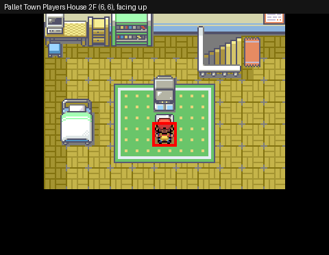

## C0_02_CHOOSE_STARTER

*Choose the starter*

| Start at step | Place | Tile (x, y) | Facing | Why | Next step |
|---|---|---|---|---|---|
| **1** | Pallet Town Professor Oaks Lab | (6, 4) | up | Start of the segment. *No save here*: the segment before goes on into this one | WALK: StarterBall |

**Step 1:** Pallet Town Professor Oaks Lab (6, 4), facing up

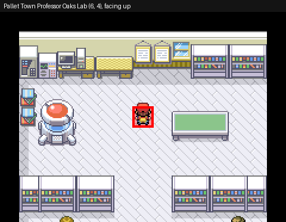

## C0_03_RIVAL_BATTLE

*First rival battle*

| Start at step | Place | Tile (x, y) | Facing | Why | Next step |
|---|---|---|---|---|---|
| **1** | Pallet Town Professor Oaks Lab | (10, 5) | up | Start of the segment (the segment before saves here) | WALK: ToRivalTrigger |

**Step 1:** Pallet Town Professor Oaks Lab (10, 5), facing up

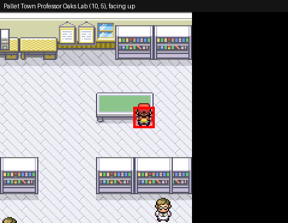

## C0_04_TO_VIRIDIAN_MART

*Route 1 -> Viridian City -> Poke Mart (Oak's Parcel)*

| Start at step | Place | Tile (x, y) | Facing | Why | Next step |
|---|---|---|---|---|---|
| **1** | Pallet Town Professor Oaks Lab | (7, 8) | down | Start of the segment (the segment before saves here) | WALK: LabToViridianMart |

**Step 1:** Pallet Town Professor Oaks Lab (7, 8), facing down

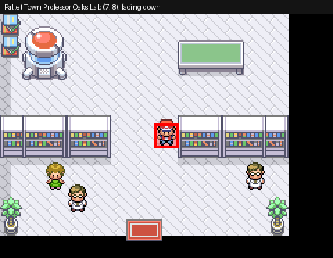

## C0_05_PARCEL_TO_OAK

*Parcel to Oak -> Pokedex*

| Start at step | Place | Tile (x, y) | Facing | Why | Next step |
|---|---|---|---|---|---|
| **1** | Viridian City Mart | (4, 3) | left | Start of the segment (the segment before saves here) | WALK: ToOak |

**Step 1:** Viridian City Mart (4, 3), facing left

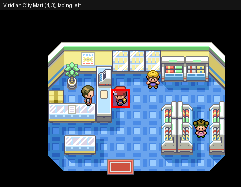

## C1_01_VIRIDIAN_PC

*To the Viridian City Pokemon Center*

| Start at step | Place | Tile (x, y) | Facing | Why | Next step |
|---|---|---|---|---|---|
| **1** | Pallet Town Professor Oaks Lab | (6, 4) | up | Start of the segment (the segment before saves here) | WALK: LabToViridianPC |

**Step 1:** Pallet Town Professor Oaks Lab (6, 4), facing up

## C1_02_GRIND_ROUTE2

*Old man's catching tutorial, train on Route 2 (south)*

| Start at step | Place | Tile (x, y) | Facing | Why | Next step |
|---|---|---|---|---|---|
| **1** | Viridian City Pokemon Center 1F | (7, 4) | up | Start of the segment (the segment before saves here) | WALK: ToOldManTutorial |
| **7** | Viridian City Pokemon Center 1F | (7, 4) | up | After healing (with "Save after healing" on) | GRIND: GrindRoute2South |
| **8** | Viridian City Pokemon Center 1F | (7, 4) | up | Training done: at the nurse | SAVE: Save |

**Step 1, 7, 8:** Viridian City Pokemon Center 1F (7, 4), facing up

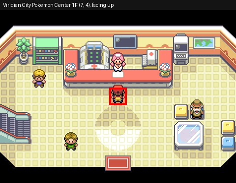

## C1_03_VIRIDIAN_FOREST

*Through Viridian Forest to Pewter City*

| Start at step | Place | Tile (x, y) | Facing | Why | Next step |
|---|---|---|---|---|---|
| **1** | Viridian City Pokemon Center 1F | (7, 4) | up | Start of the segment (the segment before saves here) | WALK: ViridianToPewterPC_ToTrainer |

**Step 1:** Viridian City Pokemon Center 1F (7, 4), facing up

## C1_04_GRIND_BROCK

*Train on Route 2 (north) for Brock*

| Start at step | Place | Tile (x, y) | Facing | Why | Next step |
|---|---|---|---|---|---|
| **1** | Pewter City Pokemon Center 1F | (7, 4) | up | Start of the segment (the segment before saves here) | GRIND: GrindForBrock |
| **2** | Pewter City Pokemon Center 1F | (7, 4) | up | Training done: at the nurse | SAVE: Save |

**Step 1, 2:** Pewter City Pokemon Center 1F (7, 4), facing up

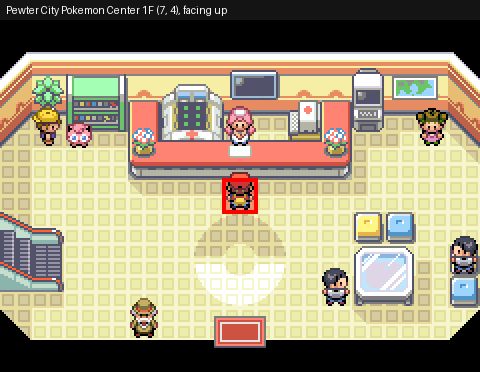

## C1_05_BROCK

*Defeat Brock (Boulder Badge)*

| Start at step | Place | Tile (x, y) | Facing | Why | Next step |
|---|---|---|---|---|---|
| **1** | Pewter City Pokemon Center 1F | (7, 4) | up | Start of the segment (the segment before saves here) | WALK: Brock |
| **8** | Pewter City Gym | (6, 6) | up | After a save | WALK: BrockToPewterPC |

**Step 1:** Pewter City Pokemon Center 1F (7, 4), facing up

**Step 8:** Pewter City Gym (6, 6), facing up

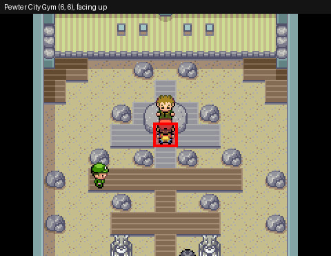

## C2_01_RUNNING_SHOES_ROUTE3

*Running Shoes, Route 3 to the Pokemon Center at Mt. Moon*

| Start at step | Place | Tile (x, y) | Facing | Why | Next step |
|---|---|---|---|---|---|
| **1** | Pewter City Pokemon Center 1F | (7, 4) | up | Start of the segment (the segment before saves here) | WALK: ToRunningShoesAide |

**Step 1:** Pewter City Pokemon Center 1F (7, 4), facing up

## C2_02_MT_MOON

*Mt. Moon: take a fossil, on to Cerulean City*

| Start at step | Place | Tile (x, y) | Facing | Why | Next step |
|---|---|---|---|---|---|
| **1** | Route 4 Pokemon Center 1F | (7, 4) | up | Start of the segment (the segment before saves here) | WALK: RareCandyMtMoon |

**Step 1:** Route 4 Pokemon Center 1F (7, 4), facing up

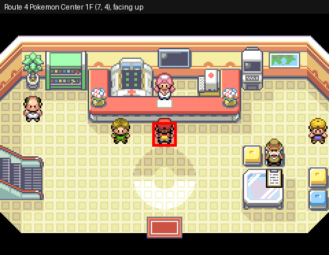

## C2_03_GRIND_RIVAL

*Train on Route 4 for the rival*

| Start at step | Place | Tile (x, y) | Facing | Why | Next step |
|---|---|---|---|---|---|
| **1** | Cerulean City Pokemon Center 1F | (7, 4) | up | Start of the segment (the segment before saves here) | GRIND: GrindRoute4 |
| **2** | Cerulean City Pokemon Center 1F | (7, 4) | up | Training done: at the nurse | SAVE: Save |

**Step 1, 2:** Cerulean City Pokemon Center 1F (7, 4), facing up

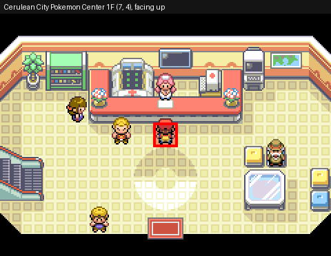

## C2_04_RIVAL_NUGGET_BRIDGE

*Rival in Cerulean, Nugget Bridge and the Rocket*

| Start at step | Place | Tile (x, y) | Facing | Why | Next step |
|---|---|---|---|---|---|
| **1** | Cerulean City Pokemon Center 1F | (7, 4) | up | Start of the segment (the segment before saves here) | WALK: ToCeruleanRival |

**Step 1:** Cerulean City Pokemon Center 1F (7, 4), facing up

## C2_05_BILL

*Help Bill (S.S. Ticket)*

| Start at step | Place | Tile (x, y) | Facing | Why | Next step |
|---|---|---|---|---|---|
| **1** | Cerulean City Pokemon Center 1F | (7, 4) | up | Start of the segment (the segment before saves here) | WALK: BillClefairy_ToTrainer |

**Step 1:** Cerulean City Pokemon Center 1F (7, 4), facing up

## C2_06_GRIND_MISTY

*Train on Route 24 for Misty (Squirtle: also catch a Cut user)*

| Start at step | Place | Tile (x, y) | Facing | Why | Next step |
|---|---|---|---|---|---|
| **1** | Cerulean City Pokemon Center 1F | (7, 4) | up | Start of the segment (the segment before saves here) | WALK: BuyPokeBalls |
| **9** | Cerulean City Pokemon Center 1F | (7, 4) | up | After healing (with "Save after healing" on) | GRIND: GrindRoute24 |
| **10** | Cerulean City Pokemon Center 1F | (7, 4) | up | Training done: at the nurse | SAVE: Save |

**Step 1, 9, 10:** Cerulean City Pokemon Center 1F (7, 4), facing up

## C2_07_MISTY

*Defeat Misty (Cascade Badge)*

| Start at step | Place | Tile (x, y) | Facing | Why | Next step |
|---|---|---|---|---|---|
| **1** | Cerulean City Pokemon Center 1F | (7, 4) | up | Start of the segment (the segment before saves here) | WALK: Misty |
| **8** | Cerulean City Gym | (9, 6) | left | After a save | WALK: MistyToCeruleanPC |

**Step 1:** Cerulean City Pokemon Center 1F (7, 4), facing up

**Step 8:** Cerulean City Gym (9, 6), facing left

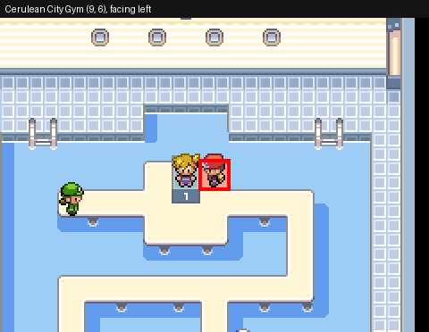

## C3_01_TO_VERMILION

*Rocket behind the house, Route 5, Underground Path, Route 6 to Vermilion City*

| Start at step | Place | Tile (x, y) | Facing | Why | Next step |
|---|---|---|---|---|---|
| **1** | Cerulean City Pokemon Center 1F | (7, 4) | up | Start of the segment (the segment before saves here) | WALK: RareCandyCerulean |

**Step 1:** Cerulean City Pokemon Center 1F (7, 4), facing up

## C3_02_SS_ANNE

*S.S. Anne: rival and the captain (HM01 Cut)*

| Start at step | Place | Tile (x, y) | Facing | Why | Next step |
|---|---|---|---|---|---|
| **1** | Vermilion City Pokemon Center 1F | (7, 4) | up | Start of the segment (the segment before saves here) | WALK: ToTicketCheck |

**Step 1:** Vermilion City Pokemon Center 1F (7, 4), facing up

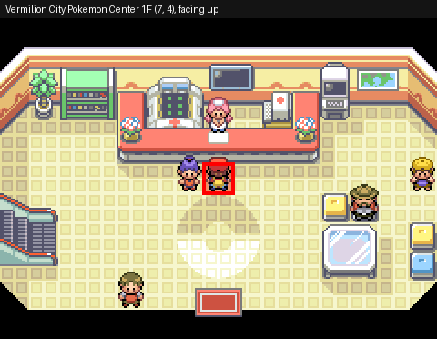

## C3_03_CUT_AND_GRIND

*Teach Cut, train on Route 11 for Lt. Surge*

| Start at step | Place | Tile (x, y) | Facing | Why | Next step |
|---|---|---|---|---|---|
| **1** | Vermilion City Pokemon Center 1F | (7, 4) | up | Start of the segment (the segment before saves here) | TEACH_HM: Teach CUT |
| **2** | Vermilion City Pokemon Center 1F | (7, 4) | up | Training: the party fainted or healed here (this step again) | GRIND: GrindRoute11 |
| **3** | Vermilion City Pokemon Center 1F | (7, 4) | up | Training done: at the nurse | SAVE: Save |

**Step 1, 2, 3:** Vermilion City Pokemon Center 1F (7, 4), facing up

## C3_04_SURGE

*Lt. Surge: trainers, trash can puzzle, Thunder Badge*

| Start at step | Place | Tile (x, y) | Facing | Why | Next step |
|---|---|---|---|---|---|
| **1** | Vermilion City Pokemon Center 1F | (7, 4) | up | Start of the segment (the segment before saves here) | WALK: Sailor Dwayne |
| **24** | Vermilion City Gym | (4, 2) | right | After a save | WALK: SurgeToVermilionPC |

**Step 1:** Vermilion City Pokemon Center 1F (7, 4), facing up

**Step 24:** Vermilion City Gym (4, 2), facing right

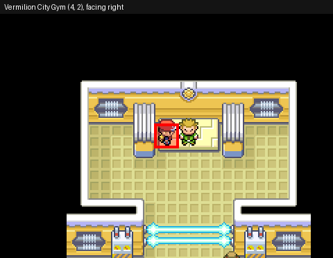

## C4_01_ROUTE9

*Back to Cerulean, Route 9 (Cut) to the Pokemon Center at Rock Tunnel*

| Start at step | Place | Tile (x, y) | Facing | Why | Next step |
|---|---|---|---|---|---|
| **1** | Vermilion City Pokemon Center 1F | (7, 4) | up | Start of the segment (the segment before saves here) | WALK: RareCandyRoute9_ToTrainer |

**Step 1:** Vermilion City Pokemon Center 1F (7, 4), facing up

## C4_02_ROCK_TUNNEL

*Catch Voltorb on Route 10, Rock Tunnel (without Flash) to Lavender Town*

| Start at step | Place | Tile (x, y) | Facing | Why | Next step |
|---|---|---|---|---|---|
| **1** | Route 10 Pokemon Center 1F | (7, 4) | up | Start of the segment (the segment before saves here) | WALK: CatchVoltorb_ToGrass |
| **8** | Route 10 Pokemon Center 1F | (7, 4) | up | After a save | WALK: PokeManiac Cooper_ToTrainer |

**Step 1, 8:** Route 10 Pokemon Center 1F (7, 4), facing up

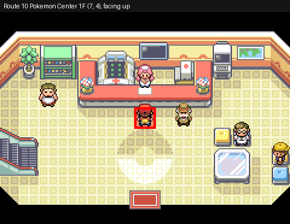

## C4_03_TO_CELADON

*Route 8, Underground Path, Route 7 to Celadon City*

| Start at step | Place | Tile (x, y) | Facing | Why | Next step |
|---|---|---|---|---|---|
| **1** | Lavender Town Pokemon Center 1F | (7, 4) | up | Start of the segment (the segment before saves here) | WALK: LavenderToCeladonPC_ToTrainer |

**Step 1:** Lavender Town Pokemon Center 1F (7, 4), facing up

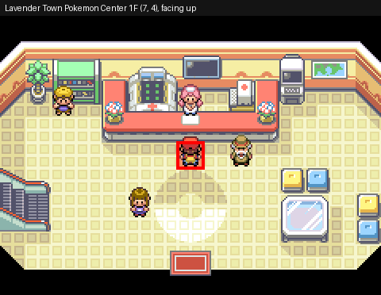

## C4_04_TEA_AND_GRIND

*Get the Tea (for the Saffron gate guards), train on Route 7*

| Start at step | Place | Tile (x, y) | Facing | Why | Next step |
|---|---|---|---|---|---|
| **1** | Celadon City Pokemon Center 1F | (7, 4) | up | Start of the segment (the segment before saves here) | WALK: TeaWoman |
| **35** | Celadon City Pokemon Center 1F | (7, 4) | up | After healing (with "Save after healing" on) | GRIND: GrindRoute7_Voltorb |
| **36** | Celadon City Pokemon Center 1F | (7, 4) | up | Training done: at the nurse | GRIND: GrindRoute7_Eevee |
| **37** | Celadon City Pokemon Center 1F | (7, 4) | up | Training done: at the nurse | GRIND: GrindRoute7 |
| **38** | Celadon City Pokemon Center 1F | (7, 4) | up | Training done: at the nurse | SAVE: Save |

**Step 1, 35, 36, 37, 38:** Celadon City Pokemon Center 1F (7, 4), facing up

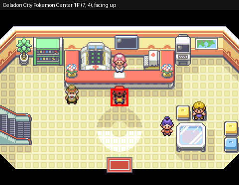

## C4_05_ERIKA

*Defeat Erika (Rainbow Badge)*

| Start at step | Place | Tile (x, y) | Facing | Why | Next step |
|---|---|---|---|---|---|
| **1** | Celadon City Pokemon Center 1F | (7, 4) | up | Start of the segment (the segment before saves here) | WALK: Erika_ToTrainer |
| **18** | Celadon City Gym | (6, 5) | up | After a save | WALK: ErikaToCeladonPC |
| **26** | Celadon City Pokemon Center 1F | (7, 4) | up | After a save | WALK: Route16HouseHM02 |

**Step 1, 26:** Celadon City Pokemon Center 1F (7, 4), facing up

**Step 18:** Celadon City Gym (6, 5), facing up

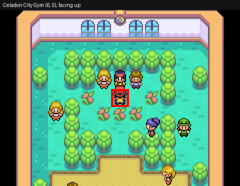

## C5_01_HIDEOUT_LIFT_KEY

*Game Corner: Rocket at the poster, into the hideout, get the Lift Key*

| Start at step | Place | Tile (x, y) | Facing | Why | Next step |
|---|---|---|---|---|---|
| **1** | Route 16 House | (4, 3) | up | Start of the segment (the segment before saves here) | WALK: GameCornerRocket_Out |

**Step 1:** Route 16 House (4, 3), facing up

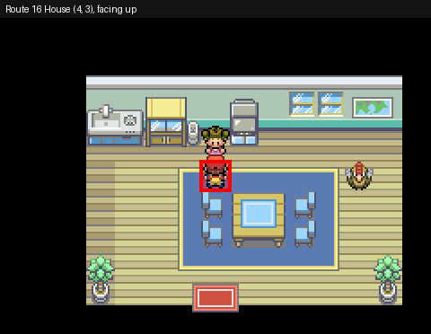

## C5_02_HIDEOUT_GIOVANNI

*Elevator to B4F, defeat Giovanni (Silph Scope)*

| Start at step | Place | Tile (x, y) | Facing | Why | Next step |
|---|---|---|---|---|---|
| **1** | Celadon City Pokemon Center 1F | (7, 4) | up | Start of the segment (the segment before saves here) | WALK: ToHideoutElevator |

**Step 1:** Celadon City Pokemon Center 1F (7, 4), facing up

## C5_03_TO_LAVENDER

*Back to Lavender Town*

| Start at step | Place | Tile (x, y) | Facing | Why | Next step |
|---|---|---|---|---|---|
| **1** | Celadon City Pokemon Center 1F | (7, 4) | up | Start of the segment (the segment before saves here) | WALK: BuyEscapeRopes_Out |

**Step 1:** Celadon City Pokemon Center 1F (7, 4), facing up

## C5_04_POKEMON_TOWER

*Pokemon Tower: Marowak ghost, Rockets, Mr. Fuji (Poke Flute)*

| Start at step | Place | Tile (x, y) | Facing | Why | Next step |
|---|---|---|---|---|---|
| **1** | Lavender Town Pokemon Center 1F | (7, 4) | up | Start of the segment (the segment before saves here) | WALK: ToTowerRival |

**Step 1:** Lavender Town Pokemon Center 1F (7, 4), facing up

## C6_01_SNORLAX_TO_FUCHSIA

*Wake Snorlax (Poke Flute), Routes 12-15 to Fuchsia City*

| Start at step | Place | Tile (x, y) | Facing | Why | Next step |
|---|---|---|---|---|---|
| **1** | Lavender Town Pokemon Center 1F | (7, 4) | up | Start of the segment (the segment before saves here) | WALK: Snorlax |

**Step 1:** Lavender Town Pokemon Center 1F (7, 4), facing up

## C6_02_SAFARI_ZONE

*Safari Zone: HM03 Surf and the Gold Teeth, the Warden gives HM04 Strength*

| Start at step | Place | Tile (x, y) | Facing | Why | Next step |
|---|---|---|---|---|---|
| **1** | Fuchsia City Pokemon Center 1F | (7, 4) | up | Start of the segment (the segment before saves here) | WALK: ToSafariDesk |

**Step 1:** Fuchsia City Pokemon Center 1F (7, 4), facing up

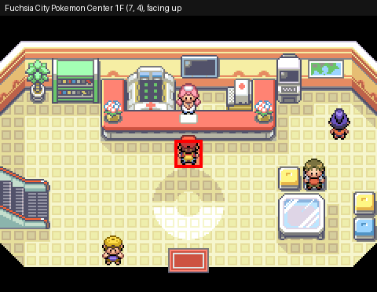

## C6_03_GRIND_KOGA

*Train on Route 15 for Koga*

| Start at step | Place | Tile (x, y) | Facing | Why | Next step |
|---|---|---|---|---|---|
| **1** | Fuchsia City Pokemon Center 1F | (7, 4) | up | Start of the segment (the segment before saves here) | GRIND: GrindRoute15_Voltorb |
| **2** | Fuchsia City Pokemon Center 1F | (7, 4) | up | Training done: at the nurse | GRIND: GrindRoute15_Eevee |
| **3** | Fuchsia City Pokemon Center 1F | (7, 4) | up | Training done: at the nurse | GRIND: GrindRoute15 |
| **4** | Fuchsia City Pokemon Center 1F | (7, 4) | up | Training done: at the nurse | SAVE: Save |

**Step 1, 2, 3, 4:** Fuchsia City Pokemon Center 1F (7, 4), facing up

## C6_04_KOGA

*Defeat Koga (Soul Badge)*

| Start at step | Place | Tile (x, y) | Facing | Why | Next step |
|---|---|---|---|---|---|
| **1** | Fuchsia City Pokemon Center 1F | (7, 4) | up | Start of the segment (the segment before saves here) | WALK: Koga_ToTrainer |
| **10** | Fuchsia City Gym | (7, 12) | down | After a save | WALK: KogaToFuchsiaPC |

**Step 1:** Fuchsia City Pokemon Center 1F (7, 4), facing up

**Step 10:** Fuchsia City Gym (7, 12), facing down

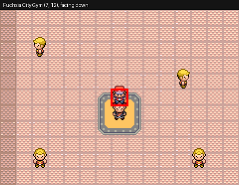

## C7_01_TO_SAFFRON

*To Saffron City (the gate guard gets the Tea)*

| Start at step | Place | Tile (x, y) | Facing | Why | Next step |
|---|---|---|---|---|---|
| **1** | Fuchsia City Pokemon Center 1F | (7, 4) | up | Start of the segment (the segment before saves here) | WALK: ToLavender_Out |

**Step 1:** Fuchsia City Pokemon Center 1F (7, 4), facing up

## C7_02_SILPH_CARD_KEY

*Silph Co.: get the Card Key on 5F*

| Start at step | Place | Tile (x, y) | Facing | Why | Next step |
|---|---|---|---|---|---|
| **1** | Saffron City Pokemon Center 1F | (7, 4) | up | Start of the segment (the segment before saves here) | WALK: CardKey |

**Step 1:** Saffron City Pokemon Center 1F (7, 4), facing up

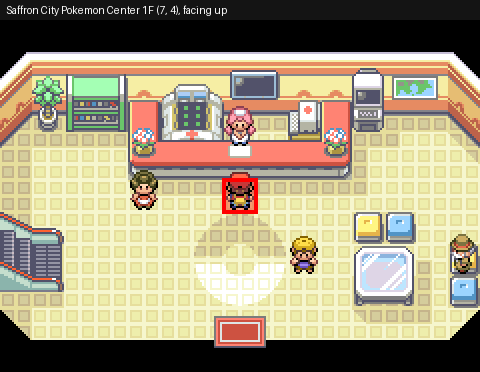

## C7_03_SILPH_GIOVANNI

*Silph Co.: rival on 7F, Lapras, Giovanni on 11F*

| Start at step | Place | Tile (x, y) | Facing | Why | Next step |
|---|---|---|---|---|---|
| **1** | Saffron City Pokemon Center 1F | (7, 4) | up | Start of the segment (the segment before saves here) | WALK: ToSilphRival_ToTrainer |

**Step 1:** Saffron City Pokemon Center 1F (7, 4), facing up

## C7_04_HMS_AND_GRIND

*Teach Surf and Strength to Lapras, train for Sabrina*

| Start at step | Place | Tile (x, y) | Facing | Why | Next step |
|---|---|---|---|---|---|
| **1** | Saffron City Pokemon Center 1F | (7, 4) | up | Start of the segment (the segment before saves here) | TEACH_HM: Teach SURF |
| **9** | Celadon City Pokemon Center 1F | (7, 4) | up | After healing (with "Save after healing" on) | GRIND: GrindRoute7Sabrina_Lapras |
| **10** | Celadon City Pokemon Center 1F | (7, 4) | up | Training done: at the nurse | GRIND: GrindRoute7Sabrina |
| **11** | Celadon City Pokemon Center 1F | (7, 4) | up | Training done: at the nurse | SAVE: Save |

**Step 1:** Saffron City Pokemon Center 1F (7, 4), facing up

**Step 9, 10, 11:** Celadon City Pokemon Center 1F (7, 4), facing up

## C7_05_SABRINA

*Defeat Sabrina (Marsh Badge)*

| Start at step | Place | Tile (x, y) | Facing | Why | Next step |
|---|---|---|---|---|---|
| **1** | Celadon City Pokemon Center 1F | (7, 4) | up | Start of the segment (the segment before saves here) | WALK: Sabrina |
| **15** | Saffron City Gym | (14, 12) | up | After a save | WALK: SabrinaToSaffronPC |

**Step 1:** Celadon City Pokemon Center 1F (7, 4), facing up

**Step 15:** Saffron City Gym (14, 12), facing up

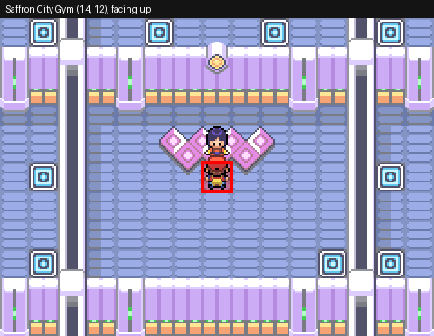

## C8_01_TO_CINNABAR

*Via Pallet Town, surf Route 21 to Cinnabar Island*

| Start at step | Place | Tile (x, y) | Facing | Why | Next step |
|---|---|---|---|---|---|
| **1** | Saffron City Pokemon Center 1F | (7, 4) | up | Start of the segment (the segment before saves here) | WALK: ToPallet_Out |

**Step 1:** Saffron City Pokemon Center 1F (7, 4), facing up

## C8_02_MANSION

*Pokemon Mansion: switches, the Secret Key*

| Start at step | Place | Tile (x, y) | Facing | Why | Next step |
|---|---|---|---|---|---|
| **1** | Cinnabar Island Pokemon Center 1F | (7, 4) | up | Start of the segment (the segment before saves here) | WALK: ToMansion |

**Step 1:** Cinnabar Island Pokemon Center 1F (7, 4), facing up

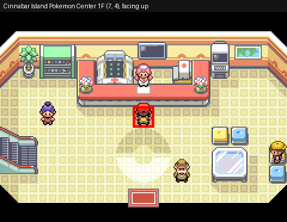

## C8_03_GRIND_BLAINE

*Train in the Pokemon Mansion for Blaine*

| Start at step | Place | Tile (x, y) | Facing | Why | Next step |
|---|---|---|---|---|---|
| **1** | Cinnabar Island Pokemon Center 1F | (7, 4) | up | Start of the segment (the segment before saves here) | GRIND: GrindMansion_Voltorb |
| **2** | Cinnabar Island Pokemon Center 1F | (7, 4) | up | Training done: at the nurse | GRIND: GrindMansion_Eevee |
| **3** | Cinnabar Island Pokemon Center 1F | (7, 4) | up | Training done: at the nurse | GRIND: GrindMansion_Lapras |
| **4** | Cinnabar Island Pokemon Center 1F | (7, 4) | up | Training done: at the nurse | GRIND: GrindMansion |
| **5** | Cinnabar Island Pokemon Center 1F | (7, 4) | up | Training done: at the nurse | SAVE: Save |

**Step 1, 2, 3, 4, 5:** Cinnabar Island Pokemon Center 1F (7, 4), facing up

## C8_04_BLAINE

*Quiz and Blaine (Volcano Badge); decline Bill's invitation*

| Start at step | Place | Tile (x, y) | Facing | Why | Next step |
|---|---|---|---|---|---|
| **1** | Cinnabar Island Pokemon Center 1F | (7, 4) | up | Start of the segment (the segment before saves here) | WALK: Quiz1 |
| **26** | Cinnabar Island Gym | (5, 5) | up | After a save | WALK: LeaveCinnabarGym |

**Step 1:** Cinnabar Island Pokemon Center 1F (7, 4), facing up

**Step 26:** Cinnabar Island Gym (5, 5), facing up

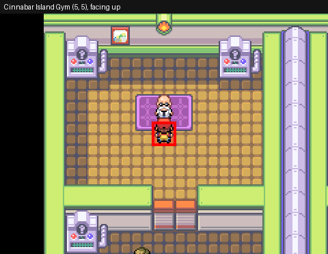

## C8_05_GRIND_GIOVANNI

*Train in the Pokemon Mansion for Giovanni*

| Start at step | Place | Tile (x, y) | Facing | Why | Next step |
|---|---|---|---|---|---|
| **1** | Cinnabar Island Pokemon Center 1F | (7, 4) | up | Start of the segment (the segment before saves here) | GRIND: GrindMansion2_Voltorb |
| **2** | Cinnabar Island Pokemon Center 1F | (7, 4) | up | Training done: at the nurse | GRIND: GrindMansion2_Eevee |
| **3** | Cinnabar Island Pokemon Center 1F | (7, 4) | up | Training done: at the nurse | GRIND: GrindMansion2_Lapras |
| **4** | Cinnabar Island Pokemon Center 1F | (7, 4) | up | Training done: at the nurse | GRIND: GrindMansion2 |
| **5** | Cinnabar Island Pokemon Center 1F | (7, 4) | up | Training done: at the nurse | SAVE: Save |

**Step 1, 2, 3, 4, 5:** Cinnabar Island Pokemon Center 1F (7, 4), facing up

## C9_01_TO_VIRIDIAN

*Back to Viridian City*

| Start at step | Place | Tile (x, y) | Facing | Why | Next step |
|---|---|---|---|---|---|
| **1** | Cinnabar Island Pokemon Center 1F | (7, 4) | up | Start of the segment (the segment before saves here) | WALK: CinnabarToViridianPC_Out |

**Step 1:** Cinnabar Island Pokemon Center 1F (7, 4), facing up

## C9_02_GIOVANNI

*Giovanni in the Viridian Gym (Earth Badge)*

| Start at step | Place | Tile (x, y) | Facing | Why | Next step |
|---|---|---|---|---|---|
| **1** | Viridian City Pokemon Center 1F | (7, 4) | up | Start of the segment (the segment before saves here) | WALK: Black Belt Takashi |
| **13** | Viridian City Gym | (2, 3) | up | After a save | WALK: GiovanniToViridianPC |

**Step 1:** Viridian City Pokemon Center 1F (7, 4), facing up

**Step 13:** Viridian City Gym (2, 3), facing up

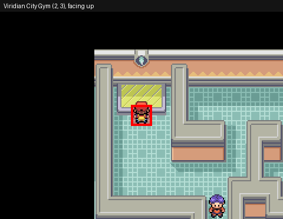

## C9_03_ROUTE22_ROUTE23

*Rival on Route 22, the badge guards on Route 23*

| Start at step | Place | Tile (x, y) | Facing | Why | Next step |
|---|---|---|---|---|---|
| **1** | Viridian City Pokemon Center 1F | (7, 4) | up | Start of the segment (the segment before saves here) | WALK: ToRoute22Rival |
| **9** | Viridian City Pokemon Center 1F | (7, 4) | up | After healing (with "Save after healing" on) | WALK: BoulderBadgeGuard |

**Step 1, 9:** Viridian City Pokemon Center 1F (7, 4), facing up

## C9_04_VICTORY_ROAD

*Victory Road: boulders onto the switches, to Indigo Plateau*

| Start at step | Place | Tile (x, y) | Facing | Why | Next step |
|---|---|---|---|---|---|
| **1** | Route 23 | (5, 35) | up | Start of the segment (the segment before saves here) | WALK: ToVictoryRoad |

**Step 1:** Route 23 (5, 35), facing up

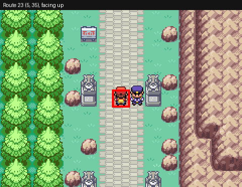

## C10_01_GRIND_LEAGUE

*Train in Victory Road for the Elite Four*

| Start at step | Place | Tile (x, y) | Facing | Why | Next step |
|---|---|---|---|---|---|
| **1** | Indigo Plateau Pokemon Center 1F | (13, 12) | up | Start of the segment (the segment before saves here) | GRIND: GrindVictoryRoad_Voltorb |
| **2** | Indigo Plateau Pokemon Center 1F | (13, 12) | up | Training done: at the nurse | GRIND: GrindVictoryRoad_Eevee |
| **3** | Indigo Plateau Pokemon Center 1F | (13, 12) | up | Training done: at the nurse | GRIND: GrindVictoryRoad_Lapras |
| **4** | Indigo Plateau Pokemon Center 1F | (13, 12) | up | Training done: at the nurse | GRIND: GrindVictoryRoad |
| **5** | Indigo Plateau Pokemon Center 1F | (13, 12) | up | Training done: at the nurse | SAVE: Save |

**Step 1, 2, 3, 4, 5:** Indigo Plateau Pokemon Center 1F (13, 12), facing up

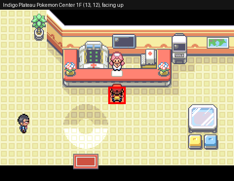

## C10_02_ITEMS

*Buy Full Restores, Revives and Ultra Balls*

| Start at step | Place | Tile (x, y) | Facing | Why | Next step |
|---|---|---|---|---|---|
| **1** | Indigo Plateau Pokemon Center 1F | (13, 12) | up | Start of the segment (the segment before saves here) | WALK: BuyFullRestore |

**Step 1:** Indigo Plateau Pokemon Center 1F (13, 12), facing up

## C10_03_ELITE_FOUR

*Elite Four: Lorelei, Bruno, Agatha, Lance*

| Start at step | Place | Tile (x, y) | Facing | Why | Next step |
|---|---|---|---|---|---|
| **1** | Indigo Plateau Pokemon Center 1F | (13, 12) | up | Start of the segment (the segment before saves here) | TEAM: Team play |
| **2** | Indigo Plateau Pokemon Center 1F | (13, 12) | up | After putting the party back in order | WALK: ToLorelei |
| **10** | Pokemon League Loreleis Room | (6, 6) | up | After a save | WALK: ToBruno |
| **18** | Pokemon League Brunos Room | (6, 6) | up | After a save | WALK: ToAgatha |
| **26** | Pokemon League Agathas Room | (6, 6) | up | After a save | WALK: ToLance |

**Step 1, 2:** Indigo Plateau Pokemon Center 1F (13, 12), facing up

**Step 10:** Pokemon League Loreleis Room (6, 6), facing up

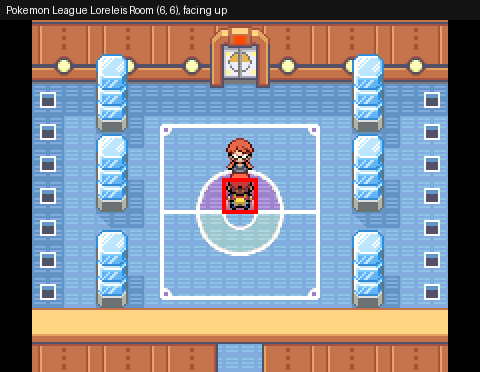

**Step 18:** Pokemon League Brunos Room (6, 6), facing up

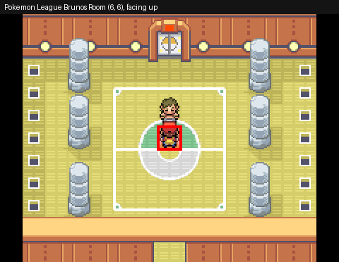

**Step 26:** Pokemon League Agathas Room (6, 6), facing up

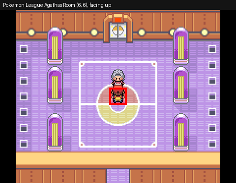

## C10_04_CHAMPION

*Champion: the rival, Hall of Fame*

| Start at step | Place | Tile (x, y) | Facing | Why | Next step |
|---|---|---|---|---|---|
| **1** | Pokemon League Lances Room | (6, 9) | up | Start of the segment (the segment before saves here) | TEAM: Team play |
| **2** | Pokemon League Lances Room | (6, 9) | up | After putting the party back in order | WALK: ToChampion |

**Step 1, 2:** Pokemon League Lances Room (6, 9), facing up

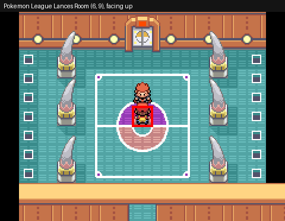

## C11_01_MASTER_BALL

*After the Hall of Fame: the Master Ball from the Silph Co. president*

| Start at step | Place | Tile (x, y) | Facing | Why | Next step |
|---|---|---|---|---|---|
| **1** | Pokemon League Champions Room | (6, 19) | up | Start of the segment. *No save here*: the segment before goes on into this one | CUTSCENE: Oak checks the Pokedex |

**Step 1:** Pokemon League Champions Room (6, 19), facing up

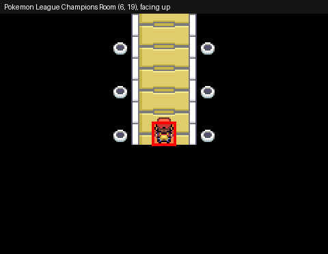

## C11_02_ZAPDOS

*Zapdos in the Power Plant (Ultra Balls; the Master Ball is kept for the roaming legendary)*

| Start at step | Place | Tile (x, y) | Facing | Why | Next step |
|---|---|---|---|---|---|
| **1** | Saffron City Pokemon Center 1F | (7, 4) | up | Start of the segment (the segment before saves here) | WALK: SaffronToFuchsiaPC_Out |
| **6** | Fuchsia City Pokemon Center 1F | (7, 4) | up | After healing (with "Save after healing" on) | WALK: BuyMaxRepels |
| **21** | Route 10 Pokemon Center 1F | (7, 4) | up | After a save | USE_REPEL: Zapdos_MaxRepel |
| **31** | Power Plant | (5, 10) | down | After a save | HEAL_ITEMS: Heal with items after Zapdos |

**Step 1:** Saffron City Pokemon Center 1F (7, 4), facing up

**Step 6:** Fuchsia City Pokemon Center 1F (7, 4), facing up

**Step 21:** Route 10 Pokemon Center 1F (7, 4), facing up

**Step 31:** Power Plant (5, 10), facing down

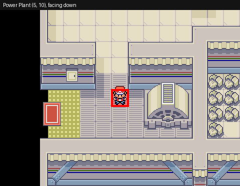

## C11_03_ARTICUNO

*Articuno in the Seafoam Islands: two boulders stop the current on B4F (Ultra Balls)*

| Start at step | Place | Tile (x, y) | Facing | Why | Next step |
|---|---|---|---|---|---|
| **1** | Route 10 Pokemon Center 1F | (7, 4) | up | Start of the segment (the segment before saves here) | WALK: Route10ToFuchsiaPC_Out |
| **7** | Fuchsia City Pokemon Center 1F | (7, 4) | up | After a save | USE_REPEL: ToSeafoamB3F_MaxRepel |
| **45** | Seafoam Islands B4F | (9, 3) | left | After a save | WALK: Articuno |
| **49** | Seafoam Islands B4F | (9, 3) | up | After a save | HEAL_ITEMS: Heal with items after Articuno |

**Step 1:** Route 10 Pokemon Center 1F (7, 4), facing up

**Step 7:** Fuchsia City Pokemon Center 1F (7, 4), facing up

**Step 45:** Seafoam Islands B4F (9, 3), facing left

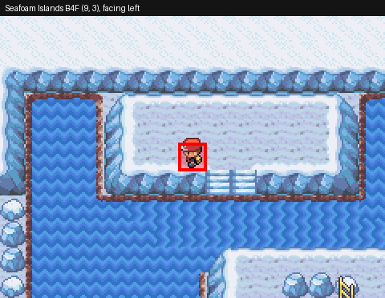

**Step 49:** Seafoam Islands B4F (9, 3), facing up

## C12_01_ONE_ISLAND

*With Bill to One Island: Celio, the Tri-Pass*

| Start at step | Place | Tile (x, y) | Facing | Why | Next step |
|---|---|---|---|---|---|
| **1** | Fuchsia City Pokemon Center 1F | (7, 4) | up | Start of the segment (the segment before saves here) | WALK: ToCinnabar_Out |

**Step 1:** Fuchsia City Pokemon Center 1F (7, 4), facing up

## C12_02_ROCK_SMASH

*Kindle Road to the Ember Spa: HM06 Rock Smash for Lapras*

| Start at step | Place | Tile (x, y) | Facing | Why | Next step |
|---|---|---|---|---|---|
| **1** | One Island Pokemon Center 1F | (5, 4) | up | Start of the segment (the segment before saves here) | WALK: RockSmashMan |

**Step 1:** One Island Pokemon Center 1F (5, 4), facing up

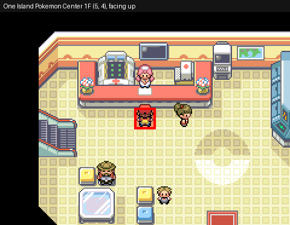

## C12_03_TWO_ISLAND

*Two Island: Lostelle is missing*

| Start at step | Place | Tile (x, y) | Facing | Why | Next step |
|---|---|---|---|---|---|
| **1** | One Island Pokemon Center 1F | (5, 4) | up | Start of the segment (the segment before saves here) | WALK: FerryToTwoIsland |

**Step 1:** One Island Pokemon Center 1F (5, 4), facing up

## C12_04_THREE_ISLAND

*Three Island: the bikers, Ultra Balls*

| Start at step | Place | Tile (x, y) | Facing | Why | Next step |
|---|---|---|---|---|---|
| **1** | Two Island Pokemon Center 1F | (7, 4) | up | Start of the segment (the segment before saves here) | WALK: FerryToThreeIsland |
| **15** | Three Island Pokemon Center 1F | (7, 4) | up | After a save | WALK: BattleBikers |
| **21** | Three Island Pokemon Center 1F | (7, 4) | up | After healing (with "Save after healing" on) | WALK: BuyMaxRepels |

**Step 1:** Two Island Pokemon Center 1F (7, 4), facing up

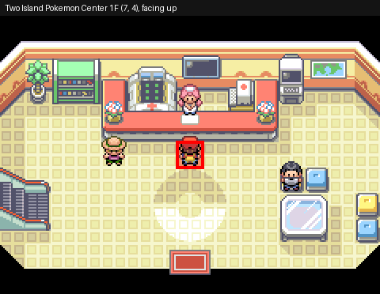

**Step 15, 21:** Three Island Pokemon Center 1F (7, 4), facing up

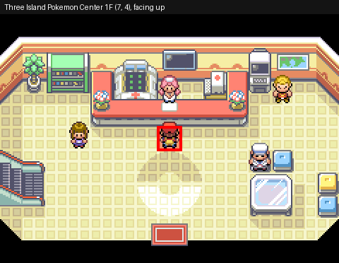

## C12_05_LOSTELLE

*Bond Bridge, Berry Forest: Lostelle; the Meteorite*

| Start at step | Place | Tile (x, y) | Facing | Why | Next step |
|---|---|---|---|---|---|
| **1** | Three Island Pokemon Center 1F | (7, 4) | up | Start of the segment (the segment before saves here) | WALK: Lostelle_ToTrainer |

**Step 1:** Three Island Pokemon Center 1F (7, 4), facing up

## C12_06_MOLTRES

*Mt. Ember: Moltres at the summit (weakened, Ultra Balls)*

| Start at step | Place | Tile (x, y) | Facing | Why | Next step |
|---|---|---|---|---|---|
| **1** | Two Island Pokemon Center 1F | (7, 4) | up | Start of the segment (the segment before saves here) | WALK: FerryToOneIsland |
| **60** | Mt Ember Summit | (9, 7) | up | After a save | WALK: Moltres |
| **64** | Mt Ember Summit | (9, 7) | up | After a save | RESET: Reload after Moltres |

**Step 1:** Two Island Pokemon Center 1F (7, 4), facing up

**Step 60, 64:** Mt Ember Summit (9, 7), facing up

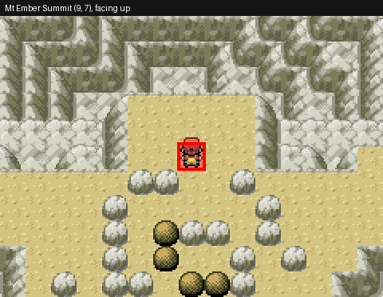

## C12_07_BACK_TO_KANTO

*Back to Kanto with Bill*

| Start at step | Place | Tile (x, y) | Facing | Why | Next step |
|---|---|---|---|---|---|
| **1** | One Island Pokemon Center 1F | (5, 4) | up | Start of the segment (the segment before saves here) | WALK: BillLeaves |

**Step 1:** One Island Pokemon Center 1F (5, 4), facing up

## C13_01_ELITE_FOUR

*Elite Four again: Lorelei, Bruno, Agatha, Lance (prize money for Poke Balls)*

| Start at step | Place | Tile (x, y) | Facing | Why | Next step |
|---|---|---|---|---|---|
| **1** | Cinnabar Island Pokemon Center 1F | (7, 4) | up | Start of the segment (the segment before saves here) | WALK: ToIndigoPlateau_Out |
| **7** | Indigo Plateau Pokemon Center 1F | (13, 12) | up | After a save | TEAM: Team play |
| **8** | Indigo Plateau Pokemon Center 1F | (13, 12) | up | After putting the party back in order | WALK: ToLorelei |
| **16** | Pokemon League Loreleis Room | (6, 6) | up | After a save | WALK: ToBruno |
| **24** | Pokemon League Brunos Room | (6, 6) | up | After a save | WALK: ToAgatha |
| **32** | Pokemon League Agathas Room | (6, 6) | up | After a save | WALK: ToLance |

**Step 1:** Cinnabar Island Pokemon Center 1F (7, 4), facing up

**Step 7, 8:** Indigo Plateau Pokemon Center 1F (13, 12), facing up

**Step 16:** Pokemon League Loreleis Room (6, 6), facing up

**Step 24:** Pokemon League Brunos Room (6, 6), facing up

**Step 32:** Pokemon League Agathas Room (6, 6), facing up

## C13_01_CHAMPION

*Champion again, Hall of Fame*

| Start at step | Place | Tile (x, y) | Facing | Why | Next step |
|---|---|---|---|---|---|
| **1** | Pokemon League Lances Room | (6, 9) | up | Start of the segment (the segment before saves here) | TEAM: Team play |
| **2** | Pokemon League Lances Room | (6, 9) | up | After putting the party back in order | WALK: ToChampion |

**Step 1, 2:** Pokemon League Lances Room (6, 9), facing up

## C13_01_OAK

*Oak's POKeDEX rating (not 60 species yet)*

| Start at step | Place | Tile (x, y) | Facing | Why | Next step |
|---|---|---|---|---|---|
| **1** | Pokemon League Champions Room | (6, 19) | up | Start of the segment. *No save here*: the segment before goes on into this one | CUTSCENE: Oak: not 60 species yet |

**Step 1:** Pokemon League Champions Room (6, 19), facing up

## C13_01_MOLTRES

*Moltres, if it was left on Mt. Ember (Great Balls from the prize money)*

| Start at step | Place | Tile (x, y) | Facing | Why | Next step |
|---|---|---|---|---|---|
| **1** | Pallet Town | (6, 8) | down | Start of the segment (the segment before saves here) | SKIP_UNLESS_LEFT: Moltres left? |
| **6** | Fuchsia City Pokemon Center 1F | (7, 4) | up | After healing (with "Save after healing" on) | WALK: BuyMaxRepels |
| **21** | Vermilion City Pokemon Center 1F | (7, 4) | up | After a save | WALK: FerryToOneIsland |
| **35** | One Island Pokemon Center 1F | (5, 4) | up | After a save | USE_REPEL: ToMtEmber_MaxRepel |
| **84** | Mt Ember Summit | (9, 7) | up | After a save | WALK: Moltres |
| **88** | Mt Ember Summit | (9, 7) | up | After a save | RESET: Reload after Moltres |
| **109** | One Island Pokemon Center 1F | (5, 4) | up | After a save | WALK: MoltresFerryHome |

**Step 1:** Pallet Town (6, 8), facing down

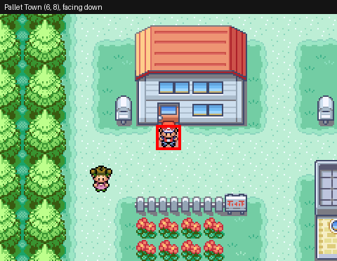

**Step 6:** Fuchsia City Pokemon Center 1F (7, 4), facing up

**Step 21:** Vermilion City Pokemon Center 1F (7, 4), facing up

**Step 35, 109:** One Island Pokemon Center 1F (5, 4), facing up

**Step 84, 88:** Mt Ember Summit (9, 7), facing up

## C13_02_ELITE_FOUR

*Elite Four again: Lorelei, Bruno, Agatha, Lance (more prize money)*

| Start at step | Place | Tile (x, y) | Facing | Why | Next step |
|---|---|---|---|---|---|
| **1** | Pallet Town | (6, 8) | down | Start of the segment (the segment before saves here) | FLY: ToIndigoPlateau_Fly |
| **6** | Indigo Plateau Pokemon Center 1F | (13, 12) | up | After a save | TEAM: Team play |
| **7** | Indigo Plateau Pokemon Center 1F | (13, 12) | up | After putting the party back in order | WALK: ToLorelei |
| **15** | Pokemon League Loreleis Room | (6, 6) | up | After a save | WALK: ToBruno |
| **23** | Pokemon League Brunos Room | (6, 6) | up | After a save | WALK: ToAgatha |
| **31** | Pokemon League Agathas Room | (6, 6) | up | After a save | WALK: ToLance |

**Step 1:** Pallet Town (6, 8), facing down

**Step 6, 7:** Indigo Plateau Pokemon Center 1F (13, 12), facing up

**Step 15:** Pokemon League Loreleis Room (6, 6), facing up

**Step 23:** Pokemon League Brunos Room (6, 6), facing up

**Step 31:** Pokemon League Agathas Room (6, 6), facing up

## C13_02_CHAMPION

*Champion again, Hall of Fame*

| Start at step | Place | Tile (x, y) | Facing | Why | Next step |
|---|---|---|---|---|---|
| **1** | Pokemon League Lances Room | (6, 9) | up | Start of the segment (the segment before saves here) | TEAM: Team play |
| **2** | Pokemon League Lances Room | (6, 9) | up | After putting the party back in order | WALK: ToChampion |

**Step 1, 2:** Pokemon League Lances Room (6, 9), facing up

## C13_02_OAK

*Oak's POKeDEX rating (not 60 species yet)*

| Start at step | Place | Tile (x, y) | Facing | Why | Next step |
|---|---|---|---|---|---|
| **1** | Pokemon League Champions Room | (6, 19) | up | Start of the segment. *No save here*: the segment before goes on into this one | CUTSCENE: Oak: not 60 species yet |

**Step 1:** Pokemon League Champions Room (6, 19), facing up

## C14_01_VIRIDIAN_FOREST

*POKeDEX: Poke Balls in Viridian City, Viridian Forest*

| Start at step | Place | Tile (x, y) | Facing | Why | Next step |
|---|---|---|---|---|---|
| **1** | Pallet Town | (6, 8) | down | Start of the segment (the segment before saves here) | FLY: ToViridianPC_Fly |
| **5** | Viridian City Pokemon Center 1F | (7, 4) | up | After healing (with "Save after healing" on) | WALK: BuyPokeBalls |

**Step 1:** Pallet Town (6, 8), facing down

**Step 5:** Viridian City Pokemon Center 1F (7, 4), facing up

## C14_02_ROUTE3_MT_MOON

*POKeDEX: more Poke Balls in Pewter City, Route 3, a Magikarp, Mt. Moon*

| Start at step | Place | Tile (x, y) | Facing | Why | Next step |
|---|---|---|---|---|---|
| **1** | Pewter City Pokemon Center 1F | (7, 4) | up | Start of the segment (the segment before saves here) | WALK: BuyEscapeRopes |
| **15** | Route 4 Pokemon Center 1F | (7, 4) | up | After a save | WALK: MagikarpSalesman |

**Step 1:** Pewter City Pokemon Center 1F (7, 4), facing up

**Step 15:** Route 4 Pokemon Center 1F (7, 4), facing up

## C14_03_POKEMON_TOWER

*POKeDEX: Pokemon Tower*

| Start at step | Place | Tile (x, y) | Facing | Why | Next step |
|---|---|---|---|---|---|
| **1** | Route 4 Pokemon Center 1F | (7, 4) | up | Start of the segment (the segment before saves here) | WALK: ToLavenderPC_Out |
| **6** | Lavender Town Pokemon Center 1F | (7, 4) | up | After healing (with "Save after healing" on) | WALK: DexPokemonTower_ToGrass |

**Step 1:** Route 4 Pokemon Center 1F (7, 4), facing up

**Step 6:** Lavender Town Pokemon Center 1F (7, 4), facing up

## C14_04_POWER_PLANT

*POKeDEX: Power Plant*

| Start at step | Place | Tile (x, y) | Facing | Why | Next step |
|---|---|---|---|---|---|
| **1** | Lavender Town Pokemon Center 1F | (7, 4) | up | Start of the segment (the segment before saves here) | WALK: ToRoute10PC_Out |
| **6** | Route 10 Pokemon Center 1F | (7, 4) | up | After healing (with "Save after healing" on) | WALK: DexPowerPlant_ToGrass |

**Step 1:** Lavender Town Pokemon Center 1F (7, 4), facing up

**Step 6:** Route 10 Pokemon Center 1F (7, 4), facing up

## C14_05_SAFARI_ZONE

*POKeDEX: two Safari Games (center, east)*

| Start at step | Place | Tile (x, y) | Facing | Why | Next step |
|---|---|---|---|---|---|
| **1** | Route 10 Pokemon Center 1F | (7, 4) | up | Start of the segment (the segment before saves here) | WALK: ToFuchsiaPC_Out |
| **7** | Fuchsia City Pokemon Center 1F | (7, 4) | up | After a save | WALK: DexSafariCenter_Desk |
| **26** | Fuchsia City Pokemon Center 1F | (7, 4) | up | After a save | WALK: DexSafariEast_Desk |

**Step 1:** Route 10 Pokemon Center 1F (7, 4), facing up

**Step 7, 26:** Fuchsia City Pokemon Center 1F (7, 4), facing up

## C14_06_SEAFOAM

*POKeDEX: Seafoam Islands*

| Start at step | Place | Tile (x, y) | Facing | Why | Next step |
|---|---|---|---|---|---|
| **1** | Fuchsia City Pokemon Center 1F | (7, 4) | up | Start of the segment (the segment before saves here) | WALK: DexSeafoam_ToGrass |

**Step 1:** Fuchsia City Pokemon Center 1F (7, 4), facing up

## C14_07_MANSION

*POKeDEX: Pokemon Mansion*

| Start at step | Place | Tile (x, y) | Facing | Why | Next step |
|---|---|---|---|---|---|
| **1** | Fuchsia City Pokemon Center 1F | (7, 4) | up | Start of the segment (the segment before saves here) | WALK: ToCinnabarPC_Out |
| **6** | Cinnabar Island Pokemon Center 1F | (7, 4) | up | After healing (with "Save after healing" on) | WALK: DexMansion_ToGrass |

**Step 1:** Fuchsia City Pokemon Center 1F (7, 4), facing up

**Step 6:** Cinnabar Island Pokemon Center 1F (7, 4), facing up

## C14_08_ROUTE11_DIGLETT

*POKeDEX: Poke Balls in Vermilion City, Route 11, Diglett's Cave*

| Start at step | Place | Tile (x, y) | Facing | Why | Next step |
|---|---|---|---|---|---|
| **1** | Cinnabar Island Pokemon Center 1F | (7, 4) | up | Start of the segment (the segment before saves here) | WALK: ToVermilionPC_Out |
| **6** | Vermilion City Pokemon Center 1F | (7, 4) | up | After healing (with "Save after healing" on) | WALK: BuyPokeBalls |

**Step 1:** Cinnabar Island Pokemon Center 1F (7, 4), facing up

**Step 6:** Vermilion City Pokemon Center 1F (7, 4), facing up

## C14_09_VICTORY_ROAD

*POKeDEX: Victory Road*

| Start at step | Place | Tile (x, y) | Facing | Why | Next step |
|---|---|---|---|---|---|
| **1** | Vermilion City Pokemon Center 1F | (7, 4) | up | Start of the segment (the segment before saves here) | WALK: ToIndigoPC_Out |
| **6** | Indigo Plateau Pokemon Center 1F | (13, 12) | up | After healing (with "Save after healing" on) | WALK: DexVictoryRoad_ToGrass |

**Step 1:** Vermilion City Pokemon Center 1F (7, 4), facing up

**Step 6:** Indigo Plateau Pokemon Center 1F (13, 12), facing up

## C14_10_KINDLE_ROAD

*POKeDEX: Poke Balls, the ferry to One Island, Kindle Road*

| Start at step | Place | Tile (x, y) | Facing | Why | Next step |
|---|---|---|---|---|---|
| **1** | Indigo Plateau Pokemon Center 1F | (13, 12) | up | Start of the segment (the segment before saves here) | WALK: ToVermilionPC_Out |
| **6** | Vermilion City Pokemon Center 1F | (7, 4) | up | After healing (with "Save after healing" on) | WALK: BuyPokeBalls |

**Step 1:** Indigo Plateau Pokemon Center 1F (13, 12), facing up

**Step 6:** Vermilion City Pokemon Center 1F (7, 4), facing up

## C14_11_BOND_BRIDGE

*POKeDEX: Three Island, Bond Bridge (Berry Forest if still short)*

| Start at step | Place | Tile (x, y) | Facing | Why | Next step |
|---|---|---|---|---|---|
| **1** | One Island Pokemon Center 1F | (5, 4) | up | Start of the segment (the segment before saves here) | WALK: FerryToThreeIsland |
| **13** | Three Island Pokemon Center 1F | (7, 4) | up | After a save | SKIP_IF_DEX: Enough species? |
| **21** | Three Island Pokemon Center 1F | (7, 4) | up | After a save | SKIP_IF_DEX: Enough species? |
| **42** | Three Island Pokemon Center 1F | (7, 4) | up | After a save | WALK: FerryToVermilion |

**Step 1:** One Island Pokemon Center 1F (5, 4), facing up

**Step 13, 21, 42:** Three Island Pokemon Center 1F (7, 4), facing up

## C15_01_ENOUGH

*60 species? Full Restores for the Elite Four*

| Start at step | Place | Tile (x, y) | Facing | Why | Next step |
|---|---|---|---|---|---|
| **1** | Vermilion City Pokemon Center 1F | (7, 4) | up | Start of the segment (the segment before saves here) | SKIP_IF_DEX: 60 species caught |
| **7** | Indigo Plateau Pokemon Center 1F | (13, 12) | up | After healing (with "Save after healing" on) | WALK: BuyFullRestore |

**Step 1:** Vermilion City Pokemon Center 1F (7, 4), facing up

**Step 7:** Indigo Plateau Pokemon Center 1F (13, 12), facing up

## C15_02_ELITE_FOUR

*Elite Four again: Lorelei, Bruno, Agatha, Lance (for the National POKeDEX)*

| Start at step | Place | Tile (x, y) | Facing | Why | Next step |
|---|---|---|---|---|---|
| **1** | Indigo Plateau Pokemon Center 1F | (13, 12) | up | Start of the segment (the segment before saves here) | HEAL: Heal at IndigoPlateau_PokemonCenter_1F |
| **3** | Indigo Plateau Pokemon Center 1F | (13, 12) | up | After a save | TEAM: Team play |
| **4** | Indigo Plateau Pokemon Center 1F | (13, 12) | up | After putting the party back in order | WALK: ToLorelei |
| **12** | Pokemon League Loreleis Room | (6, 6) | up | After a save | WALK: ToBruno |
| **20** | Pokemon League Brunos Room | (6, 6) | up | After a save | WALK: ToAgatha |
| **28** | Pokemon League Agathas Room | (6, 6) | up | After a save | WALK: ToLance |

**Step 1, 3, 4:** Indigo Plateau Pokemon Center 1F (13, 12), facing up

**Step 12:** Pokemon League Loreleis Room (6, 6), facing up

**Step 20:** Pokemon League Brunos Room (6, 6), facing up

**Step 28:** Pokemon League Agathas Room (6, 6), facing up

## C15_02_CHAMPION

*Champion again, Hall of Fame*

| Start at step | Place | Tile (x, y) | Facing | Why | Next step |
|---|---|---|---|---|---|
| **1** | Pokemon League Lances Room | (6, 9) | up | Start of the segment (the segment before saves here) | TEAM: Team play |
| **2** | Pokemon League Lances Room | (6, 9) | up | After putting the party back in order | WALK: ToChampion |

**Step 1, 2:** Pokemon League Lances Room (6, 9), facing up

## C15_03_NATIONAL_DEX

*Oak: 60 species, the National POKeDEX*

| Start at step | Place | Tile (x, y) | Facing | Why | Next step |
|---|---|---|---|---|---|
| **1** | Pokemon League Champions Room | (6, 19) | up | Start of the segment. *No save here*: the segment before goes on into this one | CUTSCENE: Oak: the National POKeDEX |

**Step 1:** Pokemon League Champions Room (6, 19), facing up

## C15_04_EXP_SHARE

*The EXP. SHARE from Oak's aide on Route 15 (50 species caught)*

| Start at step | Place | Tile (x, y) | Facing | Why | Next step |
|---|---|---|---|---|---|
| **1** | Pallet Town Professor Oaks Lab | (6, 4) | up | Start of the segment (the segment before saves here) | WALK: LabToFuchsiaPC_Out |
| **7** | Fuchsia City Pokemon Center 1F | (7, 4) | up | After a save | WALK: BuyMaxRepels |

**Step 1:** Pallet Town Professor Oaks Lab (6, 4), facing up

**Step 7:** Fuchsia City Pokemon Center 1F (7, 4), facing up

## C16_01_CELIO_RUBY

*One Island: Celio asks for the Ruby (a gem of the Sevii Islands)*

| Start at step | Place | Tile (x, y) | Facing | Why | Next step |
|---|---|---|---|---|---|
| **1** | Fuchsia City Pokemon Center 1F | (7, 4) | up | Start of the segment (the segment before saves here) | WALK: LabToVermilionPC_Out |
| **7** | Vermilion City Pokemon Center 1F | (7, 4) | up | After a save | WALK: FerryToOneIsland |
| **20** | One Island Pokemon Center 1F | (5, 4) | up | After healing (with "Save after healing" on) | WALK: CelioRuby |

**Step 1:** Fuchsia City Pokemon Center 1F (7, 4), facing up

**Step 7:** Vermilion City Pokemon Center 1F (7, 4), facing up

**Step 20:** One Island Pokemon Center 1F (5, 4), facing up

## C16_02_RUBY_PATH

*Mt. Ember: the Rockets' password, the Ruby Path, the Ruby*

| Start at step | Place | Tile (x, y) | Facing | Why | Next step |
|---|---|---|---|---|---|
| **1** | One Island Pokemon Center 1F | (5, 4) | up | Start of the segment (the segment before saves here) | USE_REPEL: RocketPassword_MaxRepel |
| **21** | Mt Ember Exterior | (42, 41) | up | After a save | WALK: ToRubyPathB2F |

**Step 1:** One Island Pokemon Center 1F (5, 4), facing up

**Step 21:** Mt Ember Exterior (42, 41), facing up

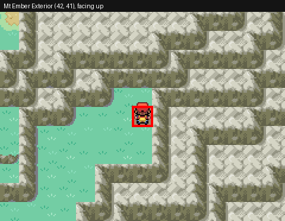

## C16_03_RAINBOW_PASS

*Celio: the Ruby in the machine, the Rainbow Pass; the Sapphire next*

| Start at step | Place | Tile (x, y) | Facing | Why | Next step |
|---|---|---|---|---|---|
| **1** | One Island Pokemon Center 1F | (5, 4) | up | Start of the segment (the segment before saves here) | WALK: CelioGiveRuby |

**Step 1:** One Island Pokemon Center 1F (5, 4), facing up

## C17_01_ICEFALL_CAVE

*Four Island, Icefall Cave: thin ice, HM07 Waterfall for Vaporeon*

| Start at step | Place | Tile (x, y) | Facing | Why | Next step |
|---|---|---|---|---|---|
| **1** | One Island Pokemon Center 1F | (5, 4) | up | Start of the segment (the segment before saves here) | WALK: FerryToFourIsland |
| **18** | Four Island Pokemon Center 1F | (7, 4) | up | After a save | WALK: ToThinIce |

**Step 1:** One Island Pokemon Center 1F (5, 4), facing up

**Step 18:** Four Island Pokemon Center 1F (7, 4), facing up

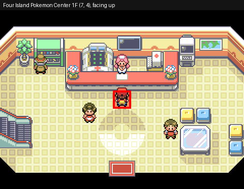

## C17_02_LORELEI

*Icefall Cave: up the waterfall, Lorelei and the poachers*

| Start at step | Place | Tile (x, y) | Facing | Why | Next step |
|---|---|---|---|---|---|
| **1** | Four Island Icefall Cave 1F | (13, 16) | left | Start of the segment (the segment before saves here) | WALK: LoreleiScene |

**Step 1:** Four Island Icefall Cave 1F (13, 16), facing left

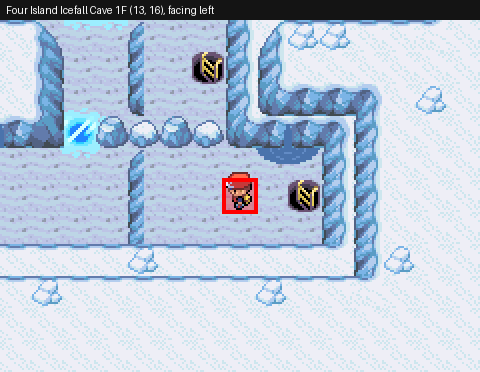

## C17_03_DOTTED_HOLE

*Six Island: Ruin Valley, the Dotted Hole, the Sapphire (Gideon takes it)*

| Start at step | Place | Tile (x, y) | Facing | Why | Next step |
|---|---|---|---|---|---|
| **1** | Four Island Pokemon Center 1F | (7, 4) | up | Start of the segment (the segment before saves here) | WALK: FerryToSixIsland |
| **16** | Six Island Pokemon Center 1F | (7, 4) | up | After a save | WALK: ToDottedHoleDoor |

**Step 1:** Four Island Pokemon Center 1F (7, 4), facing up

**Step 16:** Six Island Pokemon Center 1F (7, 4), facing up

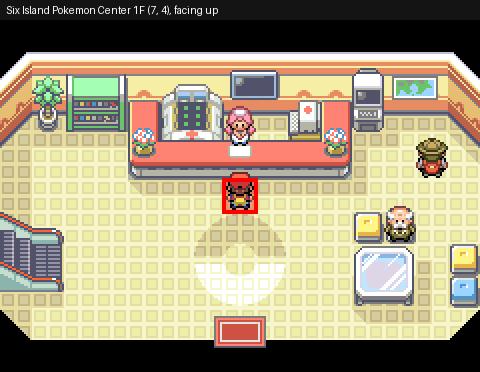

## C17_04_ROCKET_WAREHOUSE

*Five Island: the Rocket Warehouse, Gideon, the Sapphire back*

| Start at step | Place | Tile (x, y) | Facing | Why | Next step |
|---|---|---|---|---|---|
| **1** | Six Island Pokemon Center 1F | (7, 4) | up | Start of the segment (the segment before saves here) | WALK: FerryToFiveIsland |
| **15** | Five Island Pokemon Center 1F | (7, 4) | up | After a save | WALK: WarehouseDoor_ToTrainer |

**Step 1:** Six Island Pokemon Center 1F (7, 4), facing up

**Step 15:** Five Island Pokemon Center 1F (7, 4), facing up

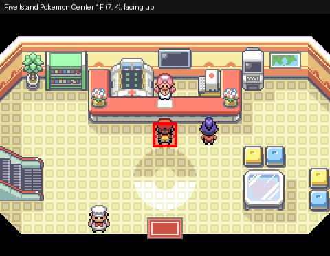

## C17_05_NETWORK_MACHINE

*One Island: the Sapphire for Celio; the roaming legendary is out*

| Start at step | Place | Tile (x, y) | Facing | Why | Next step |
|---|---|---|---|---|---|
| **1** | Five Island Pokemon Center 1F | (7, 4) | up | Start of the segment (the segment before saves here) | WALK: FerryToOneIsland |
| **12** | One Island Pokemon Center 1F | (5, 4) | up | After healing (with "Save after healing" on) | WALK: CelioSapphire |

**Step 1:** Five Island Pokemon Center 1F (7, 4), facing up

**Step 12:** One Island Pokemon Center 1F (5, 4), facing up

## C18_01_SUICUNE

*The roaming Suicune: Route 10, the MASTER BALL*

| Start at step | Place | Tile (x, y) | Facing | Why | Next step |
|---|---|---|---|---|---|
| **1** | One Island Pokemon Center 1F | (5, 4) | up | Start of the segment (the segment before saves here) | WALK: FerryToVermilion |
| **12** | Route 10 Pokemon Center 1F | (7, 4) | up | After a save | WALK: RoamingLegendary_ToGrass |

**Step 1:** One Island Pokemon Center 1F (5, 4), facing up

**Step 12:** Route 10 Pokemon Center 1F (7, 4), facing up

## C19_01_MEWTWO

*Mewtwo in Cerulean Cave (weakened, Ultra Balls)*

| Start at step | Place | Tile (x, y) | Facing | Why | Next step |
|---|---|---|---|---|---|
| **1** | Route 10 Pokemon Center 1F | (7, 4) | up | Start of the segment (the segment before saves here) | WALK: ToFuchsiaPC_Out |
| **6** | Fuchsia City Pokemon Center 1F | (7, 4) | up | After healing (with "Save after healing" on) | WALK: BuyMaxRepels |
| **21** | Cerulean City Pokemon Center 1F | (7, 4) | up | After a save | USE_REPEL: ToMewtwo_MaxRepel |
| **38** | Cerulean Cave B1F | (7, 13) | up | After a save | WALK: Mewtwo |
| **42** | Cerulean Cave B1F | (7, 13) | up | After a save | HEAL_ITEMS: Heal with items after Mewtwo |

**Step 1:** Route 10 Pokemon Center 1F (7, 4), facing up

**Step 6:** Fuchsia City Pokemon Center 1F (7, 4), facing up

**Step 21:** Cerulean City Pokemon Center 1F (7, 4), facing up

**Step 38, 42:** Cerulean Cave B1F (7, 13), facing up

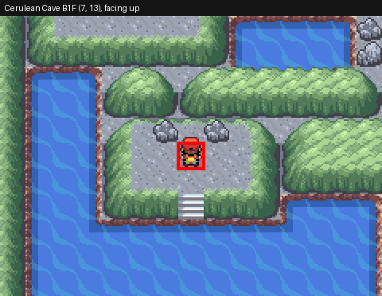

## C20_01_START

*POKeDEX collection: out of the Cerulean City Pokemon Center*

| Start at step | Place | Tile (x, y) | Facing | Why | Next step |
|---|---|---|---|---|---|
| **1** | Cerulean City Pokemon Center 1F | (7, 4) | up | Start of the segment (the segment before saves here) | WALK: C20_01_Out |

**Step 1:** Cerulean City Pokemon Center 1F (7, 4), facing up

## C20_02_CERULEAN

*POKeDEX collection: Route 24, Route 4, Cerulean Cave*

| Start at step | Place | Tile (x, y) | Facing | Why | Next step |
|---|---|---|---|---|---|
| **1** | Cerulean City | (22, 20) | down | Start of the segment. *No save here*: the segment before goes on into this one | SKIP_IF_COLLECTED: Anything to catch here? |
| **6** | Cerulean City Pokemon Center 1F | (7, 4) | up | After healing (with "Save after healing" on) | WALK: C20_02_CERULEAN_BuyPokeBalls |
| **14** | Cerulean City Pokemon Center 1F | (7, 4) | up | After healing (with "Save after healing" on) | SKIP_IF_COLLECTED: CollectRoute24? |
| **22** | Cerulean City Pokemon Center 1F | (7, 4) | up | After a save | SKIP_IF_COLLECTED: CollectRoute24_Visit2? |
| **30** | Cerulean City Pokemon Center 1F | (7, 4) | up | After a save | SKIP_IF_COLLECTED: CollectRoute4? |
| **38** | Cerulean City Pokemon Center 1F | (7, 4) | up | After a save | SKIP_IF_COLLECTED: CollectRoute4_Visit2? |
| **46** | Cerulean City Pokemon Center 1F | (7, 4) | up | After a save | SKIP_IF_COLLECTED: CollectCeruleanCaveB1F? |
| **73** | Cerulean City Pokemon Center 1F | (7, 4) | up | After a save | SKIP_IF_COLLECTED: CollectCeruleanCaveB1F_Visit2? |
| **98** | Cerulean City Pokemon Center 1F | (7, 4) | up | After a save | SKIP_IF_COLLECTED: CollectCeruleanCaveB1F_Visit3? |
| **123** | Cerulean City Pokemon Center 1F | (7, 4) | up | After a save | SKIP_IF_COLLECTED: CollectCeruleanCave1F? |
| **136** | Cerulean City Pokemon Center 1F | (7, 4) | up | After a save | SKIP_IF_COLLECTED: CollectCeruleanCave1F_Visit2? |
| **149** | Cerulean City Pokemon Center 1F | (7, 4) | up | After a save | WALK: C20_02_CERULEAN_Out |

**Step 1:** Cerulean City (22, 20), facing down

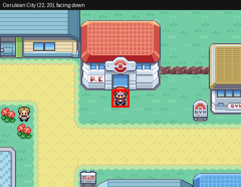

**Step 6, 14, 22, 30, 38, 46, 73, 98, 123, 136, 149:** Cerulean City Pokemon Center 1F (7, 4), facing up

## C20_03_MT_MOON

*POKeDEX collection: Mt. Moon, Route 3*

| Start at step | Place | Tile (x, y) | Facing | Why | Next step |
|---|---|---|---|---|---|
| **1** | Cerulean City | (22, 20) | down | Start of the segment. *No save here*: the segment before goes on into this one | SKIP_IF_COLLECTED: Anything to catch here? |
| **6** | Route 4 Pokemon Center 1F | (7, 4) | up | After healing (with "Save after healing" on) | SKIP_IF_COLLECTED: CollectMtMoon? |
| **20** | Route 4 Pokemon Center 1F | (7, 4) | up | After a save | SKIP_IF_COLLECTED: CollectMtMoon_Visit2? |
| **34** | Route 4 Pokemon Center 1F | (7, 4) | up | After a save | SKIP_IF_COLLECTED: CollectRoute3? |
| **42** | Route 4 Pokemon Center 1F | (7, 4) | up | After a save | SKIP_IF_COLLECTED: CollectRoute3_Visit2? |
| **50** | Route 4 Pokemon Center 1F | (7, 4) | up | After a save | WALK: C20_03_MT_MOON_Out |

**Step 1:** Cerulean City (22, 20), facing down

**Step 6, 20, 34, 42, 50:** Route 4 Pokemon Center 1F (7, 4), facing up

## C20_04_VIRIDIAN

*POKeDEX collection: Viridian Forest, Route 22, Route 23*

| Start at step | Place | Tile (x, y) | Facing | Why | Next step |
|---|---|---|---|---|---|
| **1** | Route 4 | (12, 6) | down | Start of the segment. *No save here*: the segment before goes on into this one | SKIP_IF_COLLECTED: Anything to catch here? |
| **6** | Viridian City Pokemon Center 1F | (7, 4) | up | After healing (with "Save after healing" on) | WALK: C20_04_VIRIDIAN_BuyPokeBalls |
| **14** | Viridian City Pokemon Center 1F | (7, 4) | up | After healing (with "Save after healing" on) | SKIP_IF_COLLECTED: CollectViridianForest? |
| **25** | Viridian City Pokemon Center 1F | (7, 4) | up | After a save | SKIP_IF_COLLECTED: CollectViridianForest_Visit2? |
| **36** | Viridian City Pokemon Center 1F | (7, 4) | up | After a save | SKIP_IF_COLLECTED: CollectRoute22? |
| **44** | Viridian City Pokemon Center 1F | (7, 4) | up | After a save | SKIP_IF_COLLECTED: CollectRoute22_Visit2? |
| **52** | Viridian City Pokemon Center 1F | (7, 4) | up | After a save | SKIP_IF_COLLECTED: CollectRoute23? |
| **72** | Viridian City Pokemon Center 1F | (7, 4) | up | After a save | SKIP_IF_COLLECTED: CollectRoute23_Visit2? |
| **92** | Viridian City Pokemon Center 1F | (7, 4) | up | After a save | WALK: C20_04_VIRIDIAN_Out |

**Step 1:** Route 4 (12, 6), facing down

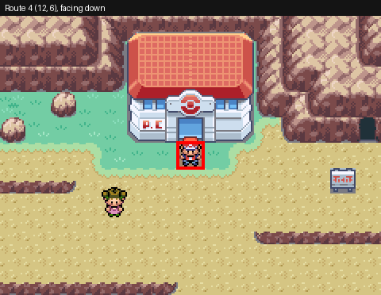

**Step 6, 14, 25, 36, 44, 52, 72, 92:** Viridian City Pokemon Center 1F (7, 4), facing up

## C20_05_VICTORY_ROAD

*POKeDEX collection: Victory Road*

| Start at step | Place | Tile (x, y) | Facing | Why | Next step |
|---|---|---|---|---|---|
| **1** | Viridian City | (26, 27) | down | Start of the segment. *No save here*: the segment before goes on into this one | SKIP_IF_COLLECTED: Anything to catch here? |
| **6** | Indigo Plateau Pokemon Center 1F | (13, 12) | up | After healing (with "Save after healing" on) | SKIP_IF_COLLECTED: CollectVictoryRoad? |
| **16** | Indigo Plateau Pokemon Center 1F | (13, 12) | up | After a save | SKIP_IF_COLLECTED: CollectVictoryRoad_Visit2? |
| **26** | Indigo Plateau Pokemon Center 1F | (13, 12) | up | After a save | WALK: C20_05_VICTORY_ROAD_Out |

**Step 1:** Viridian City (26, 27), facing down

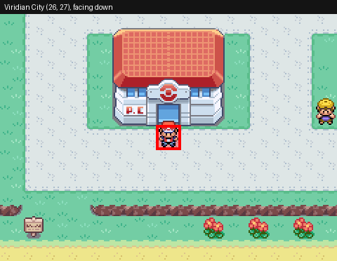

**Step 6, 16, 26:** Indigo Plateau Pokemon Center 1F (13, 12), facing up

## C20_06_ROUTE10

*POKeDEX collection: Power Plant, Rock Tunnel*

| Start at step | Place | Tile (x, y) | Facing | Why | Next step |
|---|---|---|---|---|---|
| **1** | Indigo Plateau Exterior | (11, 7) | down | Start of the segment. *No save here*: the segment before goes on into this one | SKIP_IF_COLLECTED: Anything to catch here? |
| **6** | Route 10 Pokemon Center 1F | (7, 4) | up | After healing (with "Save after healing" on) | SKIP_IF_COLLECTED: CollectPowerPlant? |
| **20** | Route 10 Pokemon Center 1F | (7, 4) | up | After a save | SKIP_IF_COLLECTED: CollectPowerPlant_Visit2? |
| **34** | Route 10 Pokemon Center 1F | (7, 4) | up | After a save | SKIP_IF_COLLECTED: CollectRockTunnel? |
| **50** | Route 10 Pokemon Center 1F | (7, 4) | up | After a save | SKIP_IF_COLLECTED: CollectRockTunnel_Visit2? |
| **66** | Route 10 Pokemon Center 1F | (7, 4) | up | After a save | WALK: C20_06_ROUTE10_Out |

**Step 1:** Indigo Plateau Exterior (11, 7), facing down

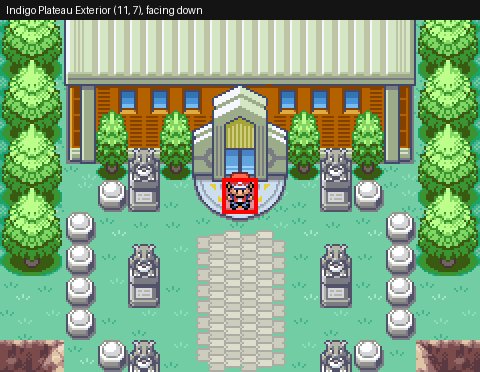

**Step 6, 20, 34, 50, 66:** Route 10 Pokemon Center 1F (7, 4), facing up

## C20_07_LAVENDER

*POKeDEX collection: Pokemon Tower, Route 8, Route 12*

| Start at step | Place | Tile (x, y) | Facing | Why | Next step |
|---|---|---|---|---|---|
| **1** | Route 10 | (13, 21) | down | Start of the segment. *No save here*: the segment before goes on into this one | SKIP_IF_COLLECTED: Anything to catch here? |
| **6** | Lavender Town Pokemon Center 1F | (7, 4) | up | After healing (with "Save after healing" on) | SKIP_IF_COLLECTED: CollectPokemonTower? |
| **28** | Lavender Town Pokemon Center 1F | (7, 4) | up | After a save | SKIP_IF_COLLECTED: CollectPokemonTower_Visit2? |
| **50** | Lavender Town Pokemon Center 1F | (7, 4) | up | After a save | SKIP_IF_COLLECTED: CollectRoute8? |
| **61** | Lavender Town Pokemon Center 1F | (7, 4) | up | After a save | SKIP_IF_COLLECTED: CollectRoute8_Visit2? |
| **72** | Lavender Town Pokemon Center 1F | (7, 4) | up | After a save | SKIP_IF_COLLECTED: CollectRoute12? |
| **104** | Lavender Town Pokemon Center 1F | (7, 4) | up | After a save | SKIP_IF_COLLECTED: CollectRoute12_Visit2? |
| **136** | Lavender Town Pokemon Center 1F | (7, 4) | up | After a save | WALK: C20_07_LAVENDER_Out |

**Step 1:** Route 10 (13, 21), facing down

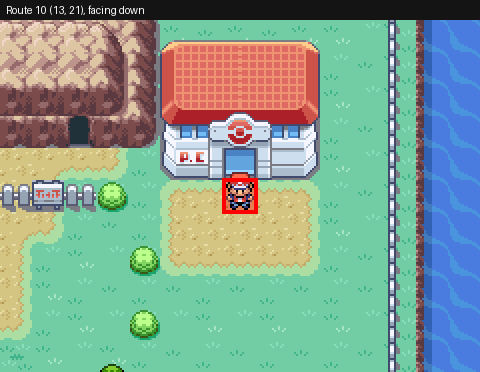

**Step 6, 28, 50, 61, 72, 104, 136:** Lavender Town Pokemon Center 1F (7, 4), facing up

## C20_08_CELADON

*POKeDEX collection: Route 16*

| Start at step | Place | Tile (x, y) | Facing | Why | Next step |
|---|---|---|---|---|---|
| **1** | Lavender Town | (6, 6) | down | Start of the segment. *No save here*: the segment before goes on into this one | SKIP_IF_COLLECTED: Anything to catch here? |
| **6** | Celadon City Pokemon Center 1F | (7, 4) | up | After healing (with "Save after healing" on) | SKIP_IF_COLLECTED: CollectRoute16? |
| **17** | Celadon City Pokemon Center 1F | (7, 4) | up | After a save | SKIP_IF_COLLECTED: CollectRoute16_Visit2? |
| **28** | Celadon City Pokemon Center 1F | (7, 4) | up | After a save | WALK: C20_08_CELADON_Out |

**Step 1:** Lavender Town (6, 6), facing down

**Step 6, 17, 28:** Celadon City Pokemon Center 1F (7, 4), facing up

## C20_09_FUCHSIA

*POKeDEX collection: Safari Zone, Routes 14, 15, 18, Seafoam Islands*

| Start at step | Place | Tile (x, y) | Facing | Why | Next step |
|---|---|---|---|---|---|
| **1** | Celadon City | (48, 12) | down | Start of the segment. *No save here*: the segment before goes on into this one | SKIP_IF_COLLECTED: Anything to catch here? |
| **6** | Fuchsia City Pokemon Center 1F | (7, 4) | up | After healing (with "Save after healing" on) | SKIP_IF_COLLECTED: CollectSafariCenter? |
| **26** | Fuchsia City Pokemon Center 1F | (7, 4) | up | After a save | SKIP_IF_COLLECTED: CollectSafariEast? |
| **47** | Fuchsia City Pokemon Center 1F | (7, 4) | up | After a save | SKIP_IF_COLLECTED: CollectSafariNorth? |
| **74** | Fuchsia City Pokemon Center 1F | (7, 4) | up | After a save | SKIP_IF_COLLECTED: CollectSafariWest? |
| **98** | Fuchsia City Pokemon Center 1F | (7, 4) | up | After a save | SKIP_IF_COLLECTED: CollectSafariCenter2? |
| **118** | Fuchsia City Pokemon Center 1F | (7, 4) | up | After a save | SKIP_IF_COLLECTED: CollectSafariEast2? |
| **139** | Fuchsia City Pokemon Center 1F | (7, 4) | up | After a save | SKIP_IF_COLLECTED: CollectSafariNorth2? |
| **166** | Fuchsia City Pokemon Center 1F | (7, 4) | up | After a save | SKIP_IF_COLLECTED: CollectSafariWest2? |
| **190** | Fuchsia City Pokemon Center 1F | (7, 4) | up | After a save | SKIP_IF_COLLECTED: CollectRoute14? |
| **204** | Fuchsia City Pokemon Center 1F | (7, 4) | up | After a save | SKIP_IF_COLLECTED: CollectRoute14_Visit2? |
| **218** | Fuchsia City Pokemon Center 1F | (7, 4) | up | After a save | SKIP_IF_COLLECTED: CollectRoute15? |
| **229** | Fuchsia City Pokemon Center 1F | (7, 4) | up | After a save | SKIP_IF_COLLECTED: CollectRoute15_Visit2? |
| **240** | Fuchsia City Pokemon Center 1F | (7, 4) | up | After a save | SKIP_IF_COLLECTED: CollectRoute18? |
| **248** | Fuchsia City Pokemon Center 1F | (7, 4) | up | After a save | SKIP_IF_COLLECTED: CollectRoute18_Visit2? |
| **256** | Fuchsia City Pokemon Center 1F | (7, 4) | up | After a save | SKIP_IF_COLLECTED: CollectSeafoam? |
| **276** | Fuchsia City Pokemon Center 1F | (7, 4) | up | After a save | SKIP_IF_COLLECTED: CollectSeafoam_Visit2? |
| **296** | Fuchsia City Pokemon Center 1F | (7, 4) | up | After a save | WALK: C20_09_FUCHSIA_Out |

**Step 1:** Celadon City (48, 12), facing down

**Step 6, 26, 47, 74, 98, 118, 139, 166, 190, 204, 218, 229, 240, 248, 256, 276, 296:** Fuchsia City Pokemon Center 1F (7, 4), facing up

## C20_10_CINNABAR

*POKeDEX collection: Pokemon Mansion, Route 21*

| Start at step | Place | Tile (x, y) | Facing | Why | Next step |
|---|---|---|---|---|---|
| **1** | Fuchsia City | (25, 32) | down | Start of the segment. *No save here*: the segment before goes on into this one | SKIP_IF_COLLECTED: Anything to catch here? |
| **6** | Cinnabar Island Pokemon Center 1F | (7, 4) | up | After healing (with "Save after healing" on) | SKIP_IF_COLLECTED: CollectMansion? |
| **16** | Cinnabar Island Pokemon Center 1F | (7, 4) | up | After a save | SKIP_IF_COLLECTED: CollectMansion_Visit2? |
| **26** | Cinnabar Island Pokemon Center 1F | (7, 4) | up | After a save | SKIP_IF_COLLECTED: CollectRoute21? |
| **50** | Cinnabar Island Pokemon Center 1F | (7, 4) | up | After a save | SKIP_IF_COLLECTED: CollectRoute21_Visit2? |
| **74** | Cinnabar Island Pokemon Center 1F | (7, 4) | up | After a save | WALK: C20_10_CINNABAR_Out |

**Step 1:** Fuchsia City (25, 32), facing down

**Step 6, 16, 26, 50, 74:** Cinnabar Island Pokemon Center 1F (7, 4), facing up

## C20_11_VERMILION_SEVII

*POKeDEX collection: Route 11, Diglett's Cave, Route 6, the Sevii Islands*

| Start at step | Place | Tile (x, y) | Facing | Why | Next step |
|---|---|---|---|---|---|
| **1** | Cinnabar Island | (14, 12) | down | Start of the segment. *No save here*: the segment before goes on into this one | SKIP_IF_COLLECTED: Anything to catch here? |
| **6** | Vermilion City Pokemon Center 1F | (7, 4) | up | After healing (with "Save after healing" on) | WALK: C20_11_VERMILION_SEVII_BuyPokeBalls |
| **14** | Vermilion City Pokemon Center 1F | (7, 4) | up | After healing (with "Save after healing" on) | SKIP_IF_COLLECTED: CollectRoute11? |
| **22** | Vermilion City Pokemon Center 1F | (7, 4) | up | After a save | SKIP_IF_COLLECTED: CollectRoute11_Visit2? |
| **30** | Vermilion City Pokemon Center 1F | (7, 4) | up | After a save | SKIP_IF_COLLECTED: CollectDiglettsCave? |
| **42** | Vermilion City Pokemon Center 1F | (7, 4) | up | After a save | SKIP_IF_COLLECTED: CollectDiglettsCave_Visit2? |
| **54** | Vermilion City Pokemon Center 1F | (7, 4) | up | After a save | SKIP_IF_COLLECTED: CollectRoute6? |
| **62** | Vermilion City Pokemon Center 1F | (7, 4) | up | After a save | SKIP_IF_COLLECTED: CollectRoute6_Visit2? |
| **70** | Vermilion City Pokemon Center 1F | (7, 4) | up | After a save | SKIP_IF_COLLECTED: The Sevii Islands? |
| **83** | One Island Pokemon Center 1F | (5, 4) | up | After healing (with "Save after healing" on) | SKIP_IF_COLLECTED: CollectKindleRoad? |
| **97** | One Island Pokemon Center 1F | (5, 4) | up | After a save | SKIP_IF_COLLECTED: CollectKindleRoad_Visit2? |
| **111** | One Island Pokemon Center 1F | (5, 4) | up | After a save | SKIP_IF_COLLECTED: CollectTreasureBeach? |
| **125** | One Island Pokemon Center 1F | (5, 4) | up | After a save | SKIP_IF_COLLECTED: CollectTreasureBeach_Visit2? |
| **139** | One Island Pokemon Center 1F | (5, 4) | up | After a save | SKIP_IF_COLLECTED: CollectRubyPath? |
| **174** | One Island Pokemon Center 1F | (5, 4) | up | After a save | SKIP_IF_COLLECTED: CollectRubyPath_Visit2? |
| **209** | One Island Pokemon Center 1F | (5, 4) | up | After a save | WALK: OneIsland_ToHarbor |
| **222** | Two Island Pokemon Center 1F | (7, 4) | up | After healing (with "Save after healing" on) | SKIP_IF_COLLECTED: CollectCapeBrink? |
| **230** | Two Island Pokemon Center 1F | (7, 4) | up | After a save | SKIP_IF_COLLECTED: CollectCapeBrink_Visit2? |
| **238** | Two Island Pokemon Center 1F | (7, 4) | up | After a save | WALK: TwoIsland_ToHarbor |
| **251** | Three Island Pokemon Center 1F | (7, 4) | up | After healing (with "Save after healing" on) | SKIP_IF_COLLECTED: CollectBondBridge? |
| **259** | Three Island Pokemon Center 1F | (7, 4) | up | After a save | SKIP_IF_COLLECTED: CollectBondBridge_Visit2? |
| **267** | Three Island Pokemon Center 1F | (7, 4) | up | After a save | SKIP_IF_COLLECTED: CollectBerryForest? |
| **286** | Three Island Pokemon Center 1F | (7, 4) | up | After a save | SKIP_IF_COLLECTED: CollectBerryForest_Visit2? |
| **305** | Three Island Pokemon Center 1F | (7, 4) | up | After a save | WALK: ThreeIsland_ToHarbor |
| **318** | Four Island Pokemon Center 1F | (7, 4) | up | After healing (with "Save after healing" on) | SKIP_IF_COLLECTED: CollectIcefallCave? |
| **342** | Four Island Pokemon Center 1F | (7, 4) | up | After a save | SKIP_IF_COLLECTED: CollectIcefallCave_Visit2? |
| **366** | Four Island Pokemon Center 1F | (7, 4) | up | After a save | WALK: FourIsland_ToHarbor |
| **380** | Five Island Pokemon Center 1F | (7, 4) | up | After healing (with "Save after healing" on) | SKIP_IF_COLLECTED: CollectFiveIsleMeadow? |
| **388** | Five Island Pokemon Center 1F | (7, 4) | up | After a save | SKIP_IF_COLLECTED: CollectFiveIsleMeadow_Visit2? |
| **396** | Five Island Pokemon Center 1F | (7, 4) | up | After a save | SKIP_IF_COLLECTED: CollectLostCave? |
| **427** | Five Island Pokemon Center 1F | (7, 4) | up | After a save | SKIP_IF_COLLECTED: CollectLostCave_Visit2? |
| **458** | Five Island Pokemon Center 1F | (7, 4) | up | After a save | WALK: FiveIsland_ToHarbor |
| **473** | Six Island Pokemon Center 1F | (7, 4) | up | After healing (with "Save after healing" on) | SKIP_IF_COLLECTED: CollectRuinValley? |
| **493** | Six Island Pokemon Center 1F | (7, 4) | up | After a save | SKIP_IF_COLLECTED: CollectRuinValley_Visit2? |
| **513** | Six Island Pokemon Center 1F | (7, 4) | up | After a save | SKIP_IF_COLLECTED: CollectPatternBush? |
| **529** | Six Island Pokemon Center 1F | (7, 4) | up | After a save | SKIP_IF_COLLECTED: CollectPatternBush_Visit2? |
| **545** | Six Island Pokemon Center 1F | (7, 4) | up | After a save | SKIP_IF_COLLECTED: CollectWaterPath? |
| **553** | Six Island Pokemon Center 1F | (7, 4) | up | After a save | SKIP_IF_COLLECTED: CollectWaterPath_Visit2? |
| **561** | Six Island Pokemon Center 1F | (7, 4) | up | After a save | WALK: SixIsland_ToHarbor |
| **576** | Seven Island Pokemon Center 1F | (7, 4) | up | After healing (with "Save after healing" on) | SKIP_IF_COLLECTED: CollectCanyonEntrance? |
| **584** | Seven Island Pokemon Center 1F | (7, 4) | up | After a save | SKIP_IF_COLLECTED: CollectCanyonEntrance_Visit2? |
| **592** | Seven Island Pokemon Center 1F | (7, 4) | up | After a save | SKIP_IF_COLLECTED: CollectSevaultCanyon? |
| **600** | Seven Island Pokemon Center 1F | (7, 4) | up | After a save | SKIP_IF_COLLECTED: CollectSevaultCanyon_Visit2? |
| **608** | Seven Island Pokemon Center 1F | (7, 4) | up | After a save | WALK: SevenIsland_ToHarbor |
| **622** | Vermilion City Pokemon Center 1F | (7, 4) | up | After a save | WALK: C20_11_VERMILION_SEVII_Out |

**Step 1:** Cinnabar Island (14, 12), facing down

**Step 6, 14, 22, 30, 42, 54, 62, 70, 622:** Vermilion City Pokemon Center 1F (7, 4), facing up

**Step 83, 97, 111, 125, 139, 174, 209:** One Island Pokemon Center 1F (5, 4), facing up

**Step 222, 230, 238:** Two Island Pokemon Center 1F (7, 4), facing up

**Step 251, 259, 267, 286, 305:** Three Island Pokemon Center 1F (7, 4), facing up

**Step 318, 342, 366:** Four Island Pokemon Center 1F (7, 4), facing up

**Step 380, 388, 396, 427, 458:** Five Island Pokemon Center 1F (7, 4), facing up

**Step 473, 493, 513, 529, 545, 553, 561:** Six Island Pokemon Center 1F (7, 4), facing up

**Step 576, 584, 592, 600, 608:** Seven Island Pokemon Center 1F (7, 4), facing up

